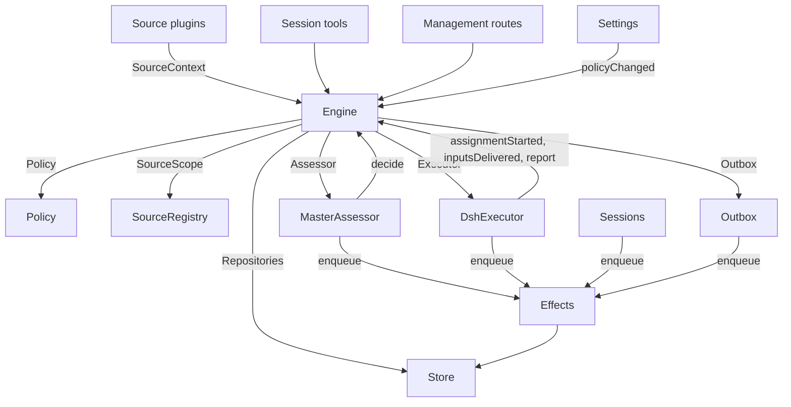

# 007 Architecture

This is the developer guide to the implementation. It maps the concepts in [001 Domain model](001-domain.md) through [006 Deployment](006-deployment.md) to classes, interfaces and files. Start with the runtime and Engine, then use the module and test tables as a code index.

## Core classes and glue

Core classes own domain concepts and external boundaries behind small interfaces. Glue translates tool arguments, HTTP requests, Source payloads and DeepSeek Harness events into calls to those classes, then turns results into cards, views and messages.

`Runtime` (`src/app/runtime.ts`) constructs the application, supplies dependencies, and owns startup and shutdown. `Engine` constructs its own internal parts. The Executor and Assessor call back into the Engine, so Runtime gives them getters rather than requiring construction in a circular order.

### Runtime

`Runtime` is the composition root; it contains no domain rules. Its constructor locks the state directory, opens the Store and builds each component. If construction fails, it closes the Store and releases the lock.

Startup registers management routes and runs Setup. After setup resolves, it installs Session and Executor hooks, ensures the main Session exists, starts Policy syncs, resumes interrupted Assignments, and starts passes and effects. `ready` marks completion of startup.

Shutdown cancels turns, waits for passes, effects and agents, restores the process environment, closes the Store and releases the lock. Source plugins inject Runtime as the `orchestrator` service through the narrow `SourceHost` interface.

| Part | Module | Does |
| --- | --- | --- |
| Setup | `src/app/setup.ts` | Resolves the repository and the accounts by probing their CLIs the way worker shells run them, writes and applies the workers' environment and command shims, and keeps the setup problems; Settings checks a changed account through it, and restarts through it, which runs setup again |
| Passes | `src/app/passes.ts` | One pass at a time, every two seconds and whenever a command asks: the due effects, then `Engine.evaluateDue`; a Source's Trigger reaches the Engine through it |
| Outbox | `src/app/outbox.ts` | The Engine's `Outbox` port, and the only writer of the receipts: `send` keeps a message's receipt and queues its `reply` effect in one transaction, and the effect's handler sends it through `SourceRegistry.send`; a message waits while its Source is off, and is dropped when the conversation is gone or not listened to |
| Notices | `src/app/notices.ts` | Converts domain events and worker activity into main-Session messages. `eventNotice` handles domain notices; `reportRelay` forwards questions immediately, keeps ordinary progress on its Ticket, and relays other reports; `followupRelay` names the Tickets that own a human follow-up. Relays arriving during a turn are delivered together at its next step through the DeepSeek Harness inbox |

### Engine

`Engine` (`src/core/engine.ts`) is the only writer of Triggers, Threads, Decisions, Tickets and Assignments. It receives these ports from `src/core/ports.ts`: `Repositories`, a current-Policy getter, `SourceScope`, `Assessor`, `Executor` and `Outbox`. Optional dependencies are `prepareTicket`, `now` and `emit`.

All Engine methods are synchronous. Each command changes its aggregates in one transaction. `evaluateDue` uses a separate transaction for each Eval or Ticket it changes. Ports enqueue external work inside the transaction; adapters perform it after commit. Invalid requests throw `UserError`.

The Engine exposes one entry point and delegates to five internal parts. It owns each command's transaction. Commands spanning parts, such as `attach`, `evaluateDue` and `policyChanged`, call the parts in sequence.

Each part extends `EnginePart` (`src/core/part.ts`), which provides options and shared reads. Dependencies between the parts flow in one direction:

| Part | Responsibility | Depends on |
| --- | --- | --- |
| `Intake` | A Source's Trigger: stored once with its disposition, recorded on its Threads and their correlations, fanned out to the subscribed Tickets and, unless it is a person's message that reached one, queued for Eval on its primary Thread | Tickets |
| `Evals` | The Evals of Threads: batching, the gate's strength, actor and basis with the Trigger that gave them (`primary`), the deadline from the candidate's delivery and its shift by a pause, the requeue of an expired Eval, candidates, replays and hand-backs, the requeue on a Policy change, and the Decision each ends with: accept, stop, ignore or unavailable | Tickets |
| `Tickets` | The Ticket lifecycle: creation from an accept with its Mandate, Subscriptions and first Assignment, the Threads it follows and their closes (`followsDone`), attached Threads and Threads followed for context, Inputs and notes, resume and the messages a resume refuses, retry, restart, stop and end, the Subscriptions it drops, and the notice of a Policy change to the Tickets it bears on | Replies |
| `Assignments` | What the Executor and its workers report: an Assignment started, Inputs reached it or failed to, a restart interrupted it, and a worker's Report with its question for a person | Tickets, Replies |
| `Replies` | Channel writes through the `Outbox`: the acknowledgement, the answer, the result and the attention message, each by the rule that allows it | Nothing |

Commands use imperative names such as `stopTicket`; facts reported by adapters use past-tense names such as `assignmentStarted`. The query `candidate` uses a noun.

Callers receive only their role's `Pick` of the Engine: `EngineForSources`, `EngineForMainSession`, `EngineForPeople`, `EngineForSettings` or `EngineForExecutor`.

| Role | Method | Effect |
| --- | --- | --- |
| Sources | `receive(trigger)` | Stores a Trigger once and answers `stored`, `duplicate`, or `filtered` when no Source receives it; fans it out to the Tickets subscribed to its Threads, where a person's message resumes an ended Ticket at once unless processing is paused, and queues it for Eval on its primary Thread, unless it is a person's message that reached a Ticket, which stays that Ticket's |
| Sources | `bindThread(ticketId, thread, own)` | Makes an open Ticket follow one of the Source's Threads, such as a pull request's, `own` when the Ticket opened it; a closed Thread bound again is open again. The Threads' closes, not a `ready` Report, end the Ticket |
| Sources | `threadClosed(thread, outcome, at)` | A Thread closed: each open Ticket that follows it records the close, and ends once it is done with the Threads it follows (`followsDone`): no Thread it opened is open, or, when it opened none, every Thread it follows closed. It ends `merged` or `closed` as the latest of those closes did, unless work resumed after the close has not reported `ready`, or its Executor took up, by acknowledging or answering it, a person's follow-up it decides after its latest Report other than `progress`, or the end of its last turn; a `dropped` Report then ends it as the close did |
| Main Session | `candidate(triggerId)` | The Eval that holds a Trigger, as its assessor sees it |
| Main Session | `candidateDelivered(evalId)` | The Eval's candidate reached the main Session: its deadline counts from now |
| Main Session | `decide(triggerId, outcome)` | Records an Eval Decision, or a direct Decision for an explicit request. Accept creates the Ticket, Mandate, Assignment, Subscriptions and acknowledgement atomically. An inferred candidate ignored from its card records `ignoredFromCard` before the supplied reason. While `followupOwners` still owns a human follow-up, only stop is allowed |
| Main Session | `attach(ticketId, triggerId, note?)` | Routes a Trigger to a Ticket it points at, whose Executor then decides it as a follow-up, and ends the Eval that holds it, whose other Triggers wait for a fresh Eval; an ended Ticket resumes under its Mandate at once unless processing is paused. A follow-up an Executor still decides is refused, as is one routed back to the Ticket that handed it back |
| Main Session | `requestStatus(ticketId)` | Asks a waiting Executor Session for its status, and answers whether it asked |
| Main Session | `note(ticketId, text)` | Gives a Ticket's Executor a fact from other work as a text Input, which grants nothing |
| Main Session, Executor | `reply(request)` | Queues a message for the Channel its purpose names: `acknowledgement`, `answer`, `result` or `attention` |
| People | `stopTicket(ticketId, reason?)` | A person's stop, which withdraws the Mandate |
| People | `retryTicket(ticketId)` | Ends the stalled Assignment of a Ticket that waits for a person after a `failed` or `blocked` Report, or whose Input delivery failed (`canRetry`), and starts a new one |
| People | `reevaluate(triggerId)` | Queues a stored Trigger for a fresh Eval |
| People | `unsubscribe(thread)` | Drops every Subscription on a Thread, and the Tickets that followed it follow it no more; each keeps deciding the follow-ups it received there |
| People | `dismiss(decisionId)` | Dismisses the problem an `unavailable` Decision shows, which the Decision records |
| Executor | `assignmentStarted(ticketId, assignmentId)` | An Assignment runs; its waiting Inputs go out |
| Executor | `inputsDelivered(ticketId, assignmentId, inputIds)` | Inputs reached the Assignment's Executor Session, where each waits for a step to take it |
| Executor | `inputsRead(ticketId, inputIds)` | The Executor Session took the messages that carry these Inputs into its history (a `user/message` Session event), from which its model has them; a step that claimed them and was cancelled or failed before does not count. Each counts as read once a Report or the end of a turn follows, also after a restart, and its Ticket's end does not let go of it; an Input delivered before reads were recorded counts as read once a Report or the end of a turn followed its delivery |
| Executor | `turnEnded(ticketId, assignmentId)` | A turn of the Executor Session ended, also after a Report, once nothing runs for it in the background or as it hands off to a person. What a step took before, it read (`inputsRead`) |
| Executor | `deliveryFailed(ticketId, assignmentId, error)` | Delivering Inputs failed; the Ticket shows it until a delivery succeeds, a new Assignment starts or the Ticket ends |
| Executor | `report(ticketId, report)` | Records a Report and its question for a person; `dropped` ends the Ticket, and `ready` completes one that follows no Thread, and ends one done with the Threads it follows as they ended |
| Executor | `markUnrelated(ticketId, thread, reason)` | Drops only that Ticket's Subscription to an attached Thread it found unrelated, and hands back, with the reason, the follow-ups there that the Ticket decides |
| Executor | `followForContext(ticketId, thread)` | Subscribes an open Ticket to a related Thread for context: its messages reach the Ticket but lend it no follow-up strength and do not resume it |
| Executor | `handback(ticketId, triggerId, reason)` | Records that the Ticket hands back a Trigger that reached it, with the reason its candidate carries, and queues it for a fresh Eval once no other Ticket decides it, if this Ticket did; it answers whether it queued it. A Ticket hands back each Trigger once and keeps its Subscription |
| Executor | `assignmentInterrupted(ticketId, assignmentId)` | An Assignment was running when the host stopped: one interrupted mid-work, or one that received an Input after its latest Report, starts again with a recovery note and the Inputs delivered to it that its Executor Session did not take, as a retry does; one that had reported since keeps its Session. The DshExecutor reports each at start (`resume`), oldest Ticket first, and queues again a launch that waits |
| Passes | `evaluateDue()` | Unless processing is paused: starts the Evals of the Threads whose queued Triggers wait, one per Thread with the Triggers queued meanwhile as one batch; queues the Triggers of an Eval past its deadline again, twice in a row, and records it `unavailable` the third time; and resumes the ended Tickets a person's message reached during a pause, if their Mandates still hold. An Eval whose candidate has not reached the main Session does not expire. While processing is paused, no Eval expires, and once it resumes each deadline moves later by the pause's length |
| Settings | `policyChanged(from, to, effects)` | Tells each live Ticket the change bears on how (`policyEffects` in `src/policy.ts`: a rule it was accepted under changed or no longer applies, its requester may no longer start work, or proactive work is no longer accepted), and restarts the Evals in progress under the new version |

The Engine keeps batching, authorization, fan-out, resume and attention lifecycle rules private. Several shared predicates make these rules consistent:

- `waitsForPerson` (`src/core/model.ts`): the latest Assignment reported `blocked` or `failed`, and no human message has arrived since. Automatic Inputs and failed launches remain held while this is true.
- `followupOwners`: the Tickets still responsible for a human follow-up received on their own Threads. A Ticket can be live or ended without a human stop and waiting to resume. Handing back the message ends that ownership.
- `settled`: a Decision resolved the request; stop, unavailable, routed and refused-stop Decisions do not count.
- `ticketStage` (`src/core/stage.ts`): implements the stage table in [003 Execution](003-execution.md).

When a Ticket ends, unread follow-ups return to Eval unless another Ticket still owns them or another disposition settled them. Acknowledged, answered and handed-back messages are excluded. For older records without acknowledgement dispositions, the outbox receipt supplies that fact. A final Report also covers messages waiting when the Assignment began, including the message that resumed it. The message that stopped a Ticket is not automatically re-evaluated.

After a change, the Engine emits an event from `DomainEvents` in `src/core/ports.ts`:

`trigger.received`, `eval.started`, `decision.recorded`, `ticket.created`, `ticket.resumed`, `ticket.ended`, `assignment.started`, `assignment.ended`, `thread.subscribed`, `thread.unsubscribed`, `trigger.requeued`, or `policy.changed`.

Runtime turns `ticket.ended`, `trigger.requeued` and `thread.unsubscribed` into notices. A human `trigger.received` delivered to Tickets becomes a follow-up relay. `pullEndNotices` sends one chat notice, using a stable id, when a Ticket ends merged or closed. Other events currently have no consumer.

### Model

`src/core/model.ts` holds the domain types, and `src/core/stage.ts` the Ticket stages. A Decision records why as `reason`, a list of `Reason`s (`src/core/reasons.ts`): each a `code` with its `values` and, for one Trigger of a batch, its `triggerId`.

The core's codes, such as `timeout`, `policyChanged`, `routed` and `startedTicket`, are `REASONS`, with the English that agents read through `reasonText`; a gate or a Source scope gives its own, such as `not_a_member`; and `said` carries words an assessor or a person wrote. The panel words each code by `reason.<code>`, and a Trigger a Source filtered records the Source's code the same way.

A Ticket keeps each fact once. It is open while it has no `ended`, which records when, by whom, why and with what outcome it ended; what it last said is its latest Assignment Report (`latestReport`); and its Executor Session is named after it (`workerSessionId` in `src/executor/dsh.ts`).

Its fields are typed: `origin`, the admissible Trigger that gave its Eval's batch its strength and the batch itself (`triggerId`, `triggerIds`); `execution`, what the Executor chose (`name`, `directory` and `assignment`); `delivery`, the last failed Input delivery (`error`, `at`), until a delivery succeeds, a new Assignment starts or the Ticket ends; and `follows`, the Threads a Source made it follow, each `{thread, own, closed?}`: `own` when the Ticket opened it, and `closed` with `at` and `outcome` once it closed. Tickets alone writes `follows`; the GitHub Source reads its pull requests with `pullsOf` and `pullOf` (`src/sources/github-pull.ts`).

An Input that carries a Trigger records whether a person wrote it, which `waitsForPerson` reads. A Thread also lists in `context` the subscribed Tickets that follow it only for context, and counts in `expired` the Evals of its queued Triggers that expired in a row; an Evaluation records its `primary` Trigger and when its candidate was `delivered`.

A Trigger's disposition records the Tickets it reached, by fan-out or attachment, a person's requeue, each Ticket that handed it back, with the reason, and each Ticket whose Executor acknowledged or answered it.

A Mandate's `basis` (`MandateBasis`) records how the gate admitted its Trigger. Revalidation reads the receiving `source`, `scope` and `row`, the listed `sender`, matched `rules`, and `via`:

| `via` | Admission basis |
| --- | --- |
| `addressed` | An allowed sender addressed the agent |
| `followup` | A message arrived on a Thread with Tickets |
| `admission` | An admission-table cell; `observation` marks an inferred candidate |
| `bot` | A listed bot produced an inferred candidate |

Trigger and Thread `meta` belong to the Source. The core does not interpret them.

### Policy

`src/policy.ts` defines settings schemas, authorization and assessment rules. `settingsPolicy(settings, scope)` returns a fresh, stateless `Policy` on each use:

- `version`, `paused` and `evalTimeoutMs` describe its current state.
- `gate(trigger, thread, tickets)` returns admission strength and basis.
- `revalidate(mandate)` checks whether an existing Mandate still holds.
- `admitsInferred(rules)` permits proactive acceptance only in auto mode with enabled matching rules.

`assessmentOutcome(assessment, settings, strength)` converts the model's assessment to an Engine outcome. It requires a judgement for every enabled rule, settled direction, a matching rule and evidence of intent. Outside auto mode, an inferred accept becomes a “would accept” record.

`policyEffects(tickets, old, now, scope)` identifies which open Tickets a change affects and how. `Engine.policyChanged` notifies only those Tickets. `policyVersion` hashes rules, accept mode and the Sources' Policy parts, including bot lists.

### Store

`Store` (`src/app/store.ts`) owns one SQLite database. Runtime acquires the directory lock before opening it, preventing a second process from migrating or writing the same state.

Its interfaces are grouped by purpose:

- **Domain repositories:** `atomic`, plus `triggers`, `threads`, `tickets` and `decisions`, each with `get`, `save` and list queries. Indexed working sets are `threads.active()`, `tickets.open()`, `tickets.active()` and `read.subscribedThreads`.
- **Read queries:** `read` serves views, tools and Source polls through methods such as `threadTriggers`, `triggerStats`, `search` and `droppedReplies`. These methods never write.
- **Source metadata:** `threads.describe` and `threads.patchMeta` update Source-owned Thread metadata.
- **Settings:** `settings`, `saveSettings`, `blockRevision` and `settingsHistory`. Settings and prompts use numbered `Versions` (`src/app/versions.ts`).
- **Outbox receipts:** `replyStatus` and `receipts`, written only by Outbox. Receipt operations are `get`, `waiting`, `behind`, `add`, `settle` and `withdraw`. `behind` checks whether an earlier message for the same Ticket and conversation is waiting with fewer than three failures. A withdrawn message settles with `channelGone` or `channelIgnored`. Read queries expose failed and dropped replies through `failingReplies`, `droppedReplies` and `droppedSince`.
- **Typed key-value records:** `get`, `set`, `delete` and `keys`, using entries from `KV`.

`afterCommit` runs an action only after the transaction commits, never after rollback. Runtime reads records in their stored shape; the schema 11 migration converts older supported records at startup.

### Effects

`Effects` (`src/app/effects.ts`) is the durable side-effect queue. A command calls `enqueue(kind, key, payload)` inside its transaction; execution begins only after commit.

Each kind/key pair has one row. Enqueuing the same waiting key replaces its payload and makes it due immediately without changing queue order. `handle(kind, run, options)` registers one handler per kind. It processes due rows oldest first, up to the concurrency limit.

Failures retry with exponential backoff. Throwing `Later` defers work without counting a failure, for example when no worker slot is available. `start` begins processing after setup, `drain` stops it during shutdown while preserving pending rows, and `pending`/`idle` expose queue state.

| Kind | Handler | Does | At once | Retry |
| --- | --- | --- | --- | --- |
| `assessment` | MasterAssessor | Steers an Eval's candidate card into the main Session's turn, then tells the Engine it was delivered, which starts the Eval's deadline | 4, none while paused | 2 s doubling to 60 s |
| `launch` | DshExecutor | Launches a pending Assignment: prepare command, Executor Session, assignment message | The free worker slots, none while paused | A passing failure of the model provider or the network runs again after 5 s doubling to 300 s, three times; any other failure, and a failed prepare command, fails its Ticket. One held by a pause or by full worker slots tries again after 5 s |
| `delivery` | DshExecutor | Hands a Ticket's waiting Inputs to its running Assignment, in order | 4, none while paused | 2 s doubling to 60 s; one that waits for a worker slot tries again after 2 s |
| `relay` | Sessions | Steers a worker's report or question, or a person's follow-up, into the main Session's turn | 1, in queue order | 2 s doubling to 60 s |
| `notice` | Sessions | Injects a notice into the main Session without waking it | 1, in queue order | 2 s doubling to 60 s |
| `reply` | Outbox | Sends a message for a Channel through its Source, after the earlier messages of its Ticket to its conversation that have not failed three times; withdrawing the message cancels it | 1, none while paused | 5 s doubling to 300 s; one whose Source is off, or behind an earlier message, tries again after 5 s |

Each kind has a health entry under its name. It reports an error once one of its effects failed three times in a row, except `delivery`, whose failures show on their Ticket instead. Relays keep their order, and so do notices; a failed one holds back the later ones of its kind.

### Sources

Sources extend the host through `SourceKind`, defined in `src/sources/kind.ts`. A kind declares its identity, title, description, configuration `schema` and `fields`, derived `facts`, and `health` entries. Optional behavior includes `scope`, a `channel` (`allowed`, `send`, `link`), `threadContext`, `find`, `policy`, `environment` and `refreshLabels`.

`SourceRegistry` (`registry.ts`) owns registered kinds and stored instances, and implements the Engine's `SourceScope`. Registration claims health entries on `HealthBoard`; duplicate claims and reserved `sync:` names are refused. A SourceContext writes only through its registration's claimed entries, so reports after unregistration do nothing.

Registry configuration methods include `kind`, `instances`, `instance`, `validate`, `validatePolicy`, `policyPart`, `channelAllowed`, `declarations`, `environments`, `find` and `scope`. `find` asks each kind that supports search.

Generic code accesses Source behavior through the registry. `send(message, commands)` calls the kind's Channel and returns `sent`, `gone` or `waiting` if the kind is not installed. `link` resolves its Channel link. `threadContext` pairs a kind's reader with its configuration, or returns nothing when the kind has no reader. Invalid stored configuration disables the instance.

Plugins receive `SourceHost`: the registry and `context(kind)`. The kind itself uses a narrower `SourceContext`, built by `sourceContextOf` in `src/app/source-context.ts`.

That context supplies deployment and commands, setup readiness (`ready`, `configured`, `problem`), configuration, `receive`, `atomic`, and typed `state`. It also exposes Thread reads and metadata writes, Ticket reads and binding/closure commands, Trigger reads, `notify` through Outbox, and `report` for declared health entries.

### DshExecutor

`DshExecutor` (`src/executor/dsh.ts`) provides one Session and directory per Ticket. `start` and `deliver` enqueue `launch` and `delivery` effects. `stop` cancels the turn through `Store.afterCommit`, so a rolled-back end does not stop the worker.

`prepare(ticket, outcome)` supplies the Engine's `prepareTicket` hook: short name, directory and `ticketExecution` assignment text. `workerSessionId(ticket.id)` derives the Session id.

`WorkerSlots` reserves capacity before a launch or a delivery that wakes an idle worker. A human message can use one slot beyond `maxWorkers`, and wakes have priority over launches. `activeCount` supplies panel load.

Transient provider and network failures get three retries. Launches use effect backoff; failed turns receive continuation messages after 15, 30 and 60 seconds. `inputMessage` renders each Input from current Ticket state, and `mandateInstructions` adds the matched-rule limits for inferred work.

`install` subscribes to Session events; `dispose` unsubscribes. A turn end normally reports waiting, except after readiness or while human action is required. Errors report failed. At startup, `resume` reports interrupted Assignments through `assignmentInterrupted` and requeues pending launches that do not wait for a person, oldest Ticket first.

### MasterAssessor

`MasterAssessor` (`src/app/assessment.ts`) lets the main Session assess proactive candidates. `request` queues an assessment effect; `release` drops cached state when its Eval ends.

Its `context`, `read` and `decide` methods serve `orchestrator_eval`, `orchestrator_eval_read` and `orchestrator_eval_decide`. They provide bounded Thread context through `SourceRegistry.threadContext`, repository context, and decision submission. A kind without a context reader supplies only the Trigger and batch.

`assessmentOutcome` converts the model's answer for `Engine.decide`. Evals checks inferred acceptance against the current Policy again.

### Settings

`Settings` (`src/app/settings.ts`) reads and writes revisioned settings blocks. `current` and `view` read them; `save(block, value, revision, origin)` validates a save; `pause(paused, origin)` changes the separate `paused` setting.

Every save declares its origin: `panel`, `tool` or `sync`. Only `panel` can change the execution environment or fields listed in `SETUP_FIELDS` (`src/deployment.ts`).

A Policy-version change calculates `policyEffects`, records which Tickets were notified, and calls `Engine.policyChanged`. `syncable` and `sync(id)` refresh a Source's Policy part. `refreshLabels(id)` refreshes display names.

### Prompts

`Prompts` (`src/app/prompts.ts`) stores configurations as `Versions`. `current`, `version` and `history` read them; `validate`, `preview` and `save(value, baseRevision, source)` check and save them. `compose` and `skills` build Session text.

`builtInParts` lists override keys, roles, default text and required template placeholders. Each override stores team `text` and a `base`: the `builtInBase` key of its original default. Saves preserve that default under `KV.prompts.builtIn`. `defaultChanged` then reports changed defaults, their old text when available, and removed parts.

Validation inherits an omitted base from the saved override, drops removed parts already present in saved data, and rejects blank text or other unknown keys. This allows the save tool to round-trip a configuration it read. `environmentSection` and `policySection` substitute template values once, using own keys only. Configurations without overrides use defaults.

### Sessions

`Sessions` (`src/app/sessions.ts`) manages DeepSeek Harness Sessions for both roles. `ensure` creates a Session with its role's model. `install` follows agent events and registers prompts, skills and tools for managed Sessions.

`prompt` delivers once per request id. `relay` and `notify` enqueue main-Session messages handled by the `relay` and `notice` effects. `src/app/notices.ts` defines their content; `delivery` checks whether a message arrived.

Each model request binds the Session to the current prompt revision. The revisions it used are stored durably: `promptVersion` identifies the active one and `mayRead` restricts which versions a worker can inspect. Registrations are tracked in one map per agent.

`status` and `promptVersion` serve prompt pages. Saves go through `Prompts.save` and notify the main Session. `modelRetry` exposes model-budget retry state.

Every model call the process makes is dispatched through DeepSeek Harness's `llm/stream` waterfall, so `Sessions` measures and records each request there against `RequestBudget` (`src/app/budget.ts`) and answers one that cannot fit with a terminal refusal chunk: its system prompt travels inside the messages, its tool definitions beside them, and the conversation and its tool results follow. **What the runtime measures is the request DSH hands its adapter, which is not the one the caller assembled.** `adapterStream` rewrites the request after the waterfall and before the adapter: it expands the Session-folded `toolHistory` into the declarations on a route whose `toolUpdate` reads tool updates (dropping them on a route that reads none), drops developer messages and the deferred-loading flag accordingly, and turns a request image into a placeholder on a route without image input. Measuring `options.messages` and `options.tools` therefore approves one request and sends another — the review's 800-character budget passed a five-character request that reached its adapter at 9,090. `measureFinalRequest` applies DSH's own projection functions in DSH's own order, with the route's metadata from `llm.resolveModelInfo`, and the record keeps what the caller declared beside what the Session's tool history holds; a request whose final size the runtime cannot establish — an unresolvable route, a file only the adapter dispatch resolves — is refused rather than reported as inside a budget. **What the runtime can see is the request DSH hands its adapter; what it cannot see is the transport.** DSH assembles, freezes and sends the request, so this is not an HTTP-level guard, the request cannot be rewritten here, and the runtime never learns what the provider received. Only the material the runtime delivers itself can be made smaller first: `prompt`, the notices it injects and the tool results it renders are paged to the room `RequestBudget.room` reports — which holds back the tool definitions the route actually declares, expanded ones included — and memory recall is assembled within `allowance`. **What that room is measured against is what the model will actually see.** DSH's compaction *replaces* a surface range and leaves the events it shadowed in the append-only log, so the room is fed `measureVisible` — DSH's own derived history for the Session's next request, the surface after every committed replacement — and never `snapshotEvents()`: the log still holds every message a compaction replaced, so measuring it reported a Session as though nothing had been compacted (an implementation review reproduced a real request with 442 characters free whose recalled-material allowance was zero, which paged a 25-character instruction away entirely). A request whose required parts alone are over is refused rather than trimmed, so current authorization is never dropped to make a request fit. What the budget did is published on the `budget` health entry — requests measured, how many were sent and how many were suspended, how many of those were DSH's own housekeeping calls, how much material was paged and how much of it was kept, the largest request against the budget in force, and, for the last request, the tool definitions it declared against what the Session's tool history held and why it was refused — so a mechanism that otherwise only refuses loudly is part of the board an operator reads.

Recalled material is measured as the part of the request it lands in (its own section text, or a message that declares `form: 'recall'`), not as a separate budget, and `budget.ts` is the contract an independent background request measures itself with as well. **A request's purpose grants it no room.** DSH makes housekeeping calls of its own — a compaction, a Session title — and carries `purpose` on them; they are measured, recorded and refused exactly like a turn, so the invariant is total: every request that is sent fits the policy, and one that does not is suspended and named. Liveness comes from bounded work instead. `SessionRecovery` (`src/app/recovery.ts`) restores a Session whose history is over by driving DSH's own compaction over one balanced surface range per step, sized so the summarization request that range implies fits the same budget; a step whose estimate was optimistic is refused at this boundary, and the gap it measured makes the next range smaller, so the bound is discovered from a real measurement rather than from a constant that could drift from DSH's own prompt. When even the smallest step cannot fit, the Session is paused with the reason and nothing is sent. The state it settles in is the last measurement's rather than the step counter's: a bounded step budget that ends on the step which made the Session fit settles `recovered` with its count and retries the title it deferred, and only a Session that is still over its budget when the steps run out is paused for that. Each step is DSH's durable `compaction/start` … `compaction/end` bracket, so a refused or interrupted step leaves the history exactly as it was and a retry re-derives its range from the current surface: a committed range is gone, so no product is committed twice, and the tool-call pairing DSH validates at both edges keeps a call and its results on the same side of the line. The states are `recovering`, `recovered` and `paused` (with its reason) on the `budget` health entry and through `Sessions.recovery`/`recovered`, and the refusal a person sees says which one their Session is in. A Session title the budget refuses is deferred until recovery or skipped with its reason and retried once through DSH's own title service, and it never holds up ordinary work or a recovery.

### Glue

| Glue | Translates |
| --- | --- |
| `src/app/runtime.ts` | The composition root: builds the parts with the interfaces they use, registers the routes and the Source host, and starts and stops dsh-superagent |
| `src/app/notices.ts` | Domain events and worker reports into notices and relays for the main Session |
| `src/app/tools/main.ts`, `src/app/tools/executor.ts` | Tool arguments of the main Session and the Executor Sessions into calls of the core classes, and their results into cards |
| `src/app/http.ts`, `src/app/views/`, `src/app/api.ts` | HTTP requests into calls, and Store reads into the panel's views; `api.ts` types every route for the panel |
| `src/app/resources.ts`, `src/app/links.ts`, `src/app/cards.ts` | Resource names into reads, source messages into links, records into compact cards for models |
| `src/sources/github*.ts`, `src/sources/feishu*.ts`, `src/sources/poll.ts` | GitHub and Feishu payloads into Triggers and Thread facts, and messages into CLI calls |
| `src/deployment.ts`, `src/setup.ts`, `src/infra/` | Setup probes and problems, CLI transport, the agent's process environment |

## Dependency rules

- **Explicit, narrow dependencies.** Each class receives an interface that names what it uses, mostly as `Pick` types of other classes: `ExecutorHost`, `AssessorHost`, `SessionsHost`, `SettingsHost`, `SetupHost`, `PassesHost` and `OutboxHost` for the core classes, and `HttpHost`, `MainToolsHost`, `ExecutorToolsHost`, `ResourceHost`, `LinkHost` and `SourceContextDeps` for the glue, with the Engine as the `Pick` of the role that calls it. The Runtime passes itself only behind such an interface. A Source plugin injects the `orchestrator` service, which its type names as a `SourceHost`: the registry and `context(kind)`; its kind's code sees only its `SourceContext`.
- **What may import what.** `src/core` imports nothing outside itself apart from Node's hashing, and does no I/O. `src/sources` imports nothing from `src/app`. The panel imports only types from the host side, and the plain values of `src/admission.ts`, `src/limits.ts`, `src/setup.ts`, `src/navigation.ts`, `src/sources/host.ts`, `src/core/errors.ts`, `src/core/reasons.ts` and the filter lists of `src/app/api.ts`.
- **One writer per state.** Each kind of state has one writer, and the others read it or ask that writer.

  | State | Writer |
  | --- | --- |
  | Triggers, Threads, Decisions, Tickets, Assignments | Engine |
  | A Source's read positions, and the meta it keeps on its Threads (`label`, `url`, `facts` and its own keys) | That Source, through `SourceContext` |
  | Settings and their history | Settings |
  | Prompt versions | Prompts |
  | Effect rows | Effects |
  | Outbox receipts | The Outbox: the Engine's messages and Sources' `notify` go through its `send`, and its `reply` effects mark them |
  | A health entry | The part that claimed it on the `HealthBoard` (`src/infra/health.ts`), which refuses a second claim: `runtime` the Runtime, which Passes report through, `evals` the Runtime after each pass, `models` Sessions, each effect kind Effects, `worker` the DshExecutor, a Source kind's entries the SourceRegistry for that kind's Source, `sync:<id>` Settings, `memory-store` the memory service and the newest reactivation cue it reports, `memory-background` the memory's background work, `budget` Sessions' request-budget usage |
  | The memory files under `<stateDir>/memory` | The memory service alone, which every capture reaches through the durable `memory` effect, so a reader only ever sees a published version. The service gates that write on the deployment's own boundary (`src/infra/isolation.ts`, `writeGate` in `src/app/memory.ts`) and refuses it with `noIsolation` when the deployment proves none |

  A Source changes a Ticket only through `SourceContext.tickets.bindThread` and `threadClosed`, which call the Engine.
- **Requests and facts.** A method that asks for something is named by an imperative verb and its object, such as `stopTicket` or `bindThread`, and may be refused; a method that records what an adapter did is named in the past tense, such as `assignmentStarted` or `deliveryFailed`. Each host receives the Engine as the role type it needs.
- **Typed fields, and Source data under the Source.** The code reads typed fields of Tickets and Mandates. A Source keeps nothing on a Ticket: which of its Threads a Ticket follows is the Ticket's `follows`, and what it keeps about a Trigger or a Thread is in their `meta`.
- **Fixed refusals.** A refusal a person or an agent can cause is a `UserError(code, values)` from `USER_ERRORS` in `src/core/errors.ts`. The management API answers a `missing` code with 404 and the others with 400, and the panel words each code in its language. Setup problems are `SetupError` codes (`src/setup.ts`) and fixed health texts `HealthCode`s (`src/sources/host.ts`), worded the same way.
### Source-specific dependencies

Some generic modules still refer directly to GitHub or Feishu:

- Outbox applies the Feishu chat word limit.
- `src/app/links.ts` resolves Feishu message links and `repliedTo`. It and Runtime read settings with `feishuSettings`.
- `src/app/resources.ts` reads the `feishu/` and `github/` originals; `src/app/cards.ts` uses `pullOf` for Ticket cards.
- Runtime sends `pullEndNotices` for merged or closed Tickets.
- Executor tools bind reported pull requests with `readPull` and `claimPull`, using the GitHub context exposed by Runtime.
- MasterAssessor reads repository files with `readRepositoryPath`.
- Sessions and Prompts register built-in skills only for GitHub and Feishu. Migration converts their schema-10 records.
- Setup probes only GitHub and Feishu account fields (`SETUP_FIELDS`). Only those Sources receive account setup problems through `SourceContext.problem`.

## Modules

| Path | Responsibility |
| --- | --- |
| `src/index.ts` | The main plugin entry: reads the machine settings, starts the Runtime, and gives it the restart that a save of a Source's account uses |
| `src/deployment.ts` | The plugin `Config` and `Machine`; `resolveDeployment` and `resolveFeishuBot` read the repository and the accounts from the Source settings, each CLI run as Executor shells run it; `SETUP_FIELDS` lists the Source fields setup reads. The code names no person, account or organization |
| `src/setup.ts` | Setup problems: `SetupError`, with a code, the place that fixes it and the English text the log, the main Session and the panel share |
| `src/policy.ts` | The Policy: the settings schemas by block, the Policy version, the gate and Mandate revalidation |
| `src/admission.ts` | The admission table's values, each cell's options and defaults, shared with the panel |
| `src/limits.ts` | The limits of the values a person sets, which the settings schemas check and the panel's fields offer |
| `src/kv.ts` | `KV`: every family of `kv` records with its key, its value's type and its owner, and the `Key` and `Family` types the Store and `SourceContext.state` take |
| `src/navigation.ts` | Opens a DeepSeek Harness Session from the panel once the host's catalog lists it |
| `src/core/model.ts` | The domain types, among them the typed Ticket and `MandateBasis`, with `threadKey`, `ticketOutcome`, `reached`, `followupOwners`, `settled`, `waitsForPerson`, `liveTicket`, `runningAssignment`, `latestAssignment` and `latestReport` |
| `src/core/ports.ts` | The ports: `Repositories`, `Policy`, `SourceScope`, `Assessor`, `Executor`, `Outbox`, and the domain events |
| `src/core/engine.ts` | The Engine, the core's entry point, and the role interfaces `EngineForSources`, `EngineForMainSession`, `EngineForPeople`, `EngineForSettings` and `EngineForExecutor` |
| `src/core/part.ts` | `EnginePart`, the base of the Engine's parts, and `EngineOptions` |
| `src/core/intake.ts` | `Intake`: Triggers from Sources, to their Tickets and, unless a person's message reached one, to Eval |
| `src/core/evals.ts` | `Evals`: the Evals of Threads and their Decisions |
| `src/core/tickets.ts` | `Tickets`: the Ticket lifecycle, the Threads a Ticket follows, Subscriptions and Inputs |
| `src/core/assignments.ts` | `Assignments`: the Executor's facts and its workers' Reports |
| `src/core/replies.ts` | `Replies`: the Engine's Channel writes |
| `src/core/stage.ts` | `ticketStage` and `canRetry`: the Ticket stages of [003 Execution](003-execution.md) |
| `src/core/errors.ts` | `UserError` and `USER_ERRORS` |
| `src/core/reasons.ts` | `Reason`, `REASONS` and `reasonText`: why the core recorded a Decision or set a Trigger aside, by code |
| `src/core/ids.ts` | `key`: ids derived from their inputs, equal for equal inputs |
| `src/core/memory.ts` | `MemoryRepositories`: the Store's repositories in memory, in the Store's order and with its nested rollback, for domain tests |
| `src/core/index.ts` | The core's exports |
| `src/app/runtime.ts` | The Runtime, the composition root, with its start and stop |
| `src/app/setup.ts` | Setup, and `setupChanged`, whether a save changes a field setup reads |
| `src/app/passes.ts` | Passes, the pass scheduler |
| `src/app/outbox.ts` | The Outbox: the Engine's `Outbox` port, the receipts and the `reply` effects that send them |
| `src/app/notices.ts` | The main Session's notices and relays: `eventNotice`, `reportRelay`, `resultRelay` and `followupRelay` |
| `src/app/store.ts` | The Store, and `Receipt`, a message of the outbox |
| `src/app/store-read.ts` | `storeReads`: the Store's read queries for the views, the tools and the Sources' polls, which never write |
| `src/app/migration.ts` | The schema 11 migration: one step from schema 10 that writes every stored record in its current shape |
| `src/app/effects.ts` | Effects |
| `src/app/redelivery.ts` | `Redelivery`: the bounded, persisted position a capture the receiving boundary refused waits at — the exact payload, its own item and payload-byte bounds, the count evicted as permanently lost, and the one transaction that hands the oldest back to the queue |
| `src/app/versions.ts` | `Versions`: a record kept as numbered snapshots with a pointer to the current one, for the settings and the prompts |
| `src/app/cache.ts` | `TextCache`: texts kept in memory within a size, the least recently used dropped first |
| `src/app/settings.ts` | Settings |
| `src/app/settings-history.ts` | `policyHistory`: each saved settings revision with what it changed from the one before |
| `src/app/prompts.ts` | Prompts, `builtInParts`, the built-in parts a team may override, and `promptParts`, the order of a role's prompt sections |
| `src/app/context.ts` | The built-in prompt text, read from `prompts/`, and the transcript entries Sessions read |
| `src/app/skill-files.ts` | Packaged text: `promptFile`, which joins a file's one-sentence lines into paragraphs, and the bundled skills |
| `src/app/sessions.ts` | Sessions |
| `src/app/delivery.ts` | `AgentDelivery`: delivers a message to a DeepSeek Harness agent once per request id, also across a restored Session |
| `src/app/retry-health.ts` | `RetryHealth`: which Sessions wait on a model budget retry, for the `models` health entry |
| `src/app/role-models.ts` | Resolves the Eval and Executor models, and seeds a new Session with its role's model |
| `src/app/assessment.ts` | The MasterAssessor, the assessment schema and the window `orchestrator_eval` answers |
| `src/app/execution-environment.ts` | The execution environment: its variables, a Ticket's values, the directory root and the lines of the prompt section, which `src/app/prompts.ts` fills into its template |
| `src/app/source-context.ts` | `sourceContextOf`: each Source kind's `SourceContext` |
| `src/app/links.ts` | `sourceLink`, the page of a Trigger's message, and `candidateCard` |
| `src/app/cards.ts` | Compact cards of Triggers, Tickets, Threads and Decisions for models, the closed set of ticket card states `TICKET_STATES`, and `textPage` |
| `src/app/resources.ts` | `RESOURCES` and `readResource`: what `orchestrator_read` reads, for each role |
| `src/app/tools/tool.ts` | The `Tool` type, `readTool`, the `orchestrator_read` of both roles, and `AcknowledgementSchema` |
| `src/app/tools/main.ts` | The main Session's tools |
| `src/app/tools/executor.ts` | An Executor Session's tools |
| `src/app/http.ts` | The `/orchestrator/api` routes: the same-origin check, request limits and one status per kind of failure |
| `src/app/api.ts` | `Api`, every route with its parameters, query, body and response, and the filters of the lists; it imports only types, so the panel bundles it |
| `src/app/views/text.ts` | The two forms of a view's text: `preview`, plain text on one line, and `markdown` without HTML; `plain` and `readable` |
| `src/app/views/records.ts` | The rows the views share: Triggers, Tickets, Threads, Decisions and Channel links, and `ownersOf`, the owners of follow-ups as one request reads them |
| `src/app/views/tickets.ts` | The Ticket lists by stage, a Ticket's page, the Mandate basis facts and the Executor's load |
| `src/app/views/threads.ts` | The Thread lists, a Thread's timeline, the search and the Decision list |
| `src/app/views/sources.ts` | The Source status: each Source instance's state, its last day's counts, and what it filtered and dropped in that day |
| `src/app/views/settings.ts` | The settings page's view: each block with its revision, each Source's settings with its kind's form, and the execution environment |
| `src/app/views/overview.ts` | The overview: Tickets that need a person, problems, the last day's flow and the Executor's load |
| `src/executor/dsh.ts` | The DshExecutor, `WorkerSlots`, `ticketExecution`, `inputMessage` and `mandateInstructions` |
| `src/executor/background.ts` | A worker's background work in DeepSeek Harness, the shell jobs its Session owns (`ctx.jobs`) and its subagents (`ctx.subagents`): `runningJobs`, `untilQuiet`, `killJobs`, `collectJobs`, `stopSubagents`, `stopBackground`, `until`, and `cancelled`, the workers whose turn a stop of their subagents cancelled |
| `src/infra/commands.ts` | `Commands`, the CLI transport: `run`; `api` and `pages`, limited to the configured repository and validated; `lark` as the bot; `git`. `CliError` carries the code a command's output reports, such as a GitHub HTTP status, and a command that prints nothing fails with how it ended, never with its arguments; `validItems` skips and counts the malformed items of a list |
| `src/infra/environment.ts` | The agent's process environment: command shims, the git configuration and credential helper, `runAsWorker`, and the checks of the environment and of a Ticket's directory |
| `src/infra/paths.ts` | The package's root, where packaged files are |
| `src/infra/text.ts` | Word counts and the chat message limit, `fill` and `sameName` |
| `src/infra/health.ts` | The `HealthBoard`, every part's health entry, each claimed by its one writer |
| `src/infra/isolation.ts` | The deployment's own boundary around the memory files, measured as evidence: `probeIsolation`, the four gates a shell would have to get past (a sandbox backend that enforces a preset in full, a confining preset no approval can widen, the memory directory outside the roots a shell may write, no link on the way there), and the facts it records instead — platform, account, whether the state directory takes a write, the directory's own permissions |
| `src/sources/kind.ts` | The `SourceKind` protocol |
| `src/sources/registry.ts` | `SourceRegistry` |
| `src/sources/host.ts` | `SourceHost`, `SourceContext`, `Health`, `health` and the fixed health texts |
| `src/sources/poll.ts` | What GitHub and Feishu polling share: `POLL_HORIZON_MS`, `polled`, `cursorAt`, and `pollThreads`, which keeps a failure on its Thread as `pollError` |
| `src/sources/github.ts` | The GitHub kind and plugin entry, exported as `./github-watch`: a poll round of notifications, the pull requests of open Tickets with their CI, and subscribed Threads |
| `src/sources/github-trigger.ts` | GitHub comments, reviews, Issue bodies and CI changes as Triggers, and GitHub addresses |
| `src/sources/github-pull.ts` | The pull request rules: which pull requests a Ticket follows (`claimPull`, `observePull`), the closes it reports to the Engine, and `pullEndNotices`, the chat notice of a Ticket that ended merged or closed |
| `src/sources/github-channel.ts` | The GitHub Channel: comments and review thread replies, `sent` or `gone` |
| `src/sources/github-read.ts` | CI snapshots, repository reads, the `github/` resources, and `githubThreadContext`: an Issue's or pull request's conversation by page |
| `src/sources/feishu.ts` | The Feishu kind and plugin entry, exported as `./feishu-watch` |
| `src/sources/feishu-trigger.ts` | Feishu messages as Triggers, by one rule for live events, history pages and topic pages |
| `src/sources/feishu-loops.ts` | The Feishu loops: the event consumer, history recovery, chat names and polling of subscribed topics |
| `src/sources/feishu-channel.ts` | The Feishu Channel: topic replies, `sent` or `gone` |
| `src/sources/feishu-read.ts` | The `feishu/` reads of a Trigger's message, its root, parent and topic, and `feishuThreadContext`, which gives them to assessments with their images |
| `src/sources/admission-context.ts` | The bounded window an assessment starts from: the first pages of a Trigger's Thread, read through its kind, and the messages around the Trigger |
| `src/sources/feishu-image.ts` | Reads a Feishu message's image as an attachment for the assessing Session |
| `src/client/index.tsx` | The client plugin entry: the sidebar entry, the main panel and the page in DeepSeek Harness's Plugin Manager |
| `src/client/app.tsx` | The panel: header, search, glossary, tabs and the page of the current route |
| `src/client/provider.tsx` | What every page reads from its host: copy, calls, navigation, notices, the state poll, and `restart`, which reads the state quickly while dsh-superagent restarts |
| `src/client/api.ts` | Calls and polls of the management API, typed by `src/app/api.ts`, and the Decision filters of the Eval status |
| `src/client/route.ts` | The tabs, the settings groups, the typed routes that `parseRoute` reads, and the route memory with the settings group opened last |
| `src/client/overview.tsx` | The overview |
| `src/client/source.tsx`, `trigger.tsx`, `eval.tsx`, `execution.tsx` | One file per stage: its status, and its settings where it has some |
| `src/client/thread.tsx`, `ticket.tsx` | The record pages: a Thread with its timeline, and a Ticket with its authorization, Inputs and Assignments |
| `src/client/settings.tsx` | The Settings tab: the group navigation and the group on screen |
| `src/client/settings-kit.tsx` | The building blocks of settings blocks: the settings the stage groups share, `useBlockDraft`, the fields, among them a Source kind's, and the history of saves |
| `src/client/prompts.tsx` | The Prompts settings: the page owns the view it read and its editor the draft, and the Edit, Full prompt and History tabs render from them; a built-in part's editor shows a changed default and keeps or drops the override |
| `src/client/prompt-config.ts` | The prompt configuration by section, by the team sections, skill names, built-in parts (`part/<key>`, with `withOverride`) and part headings the prompt views give, and the line diff of the full prompt, as pure functions |
| `src/client/deployment.tsx` | The Deployment settings, also shown in DeepSeek Harness's Plugin Manager |
| `src/client/draft.tsx` | Settings drafts: `draftReducer`, their states and their merge with a newer saved revision, `saveBarText`, the save bar's line, and the save bar |
| `src/client/controls.tsx` | Local copies of DeepSeek Harness's controls, which follow its markup, keyboard behaviour and design tokens, since the bundle does not import `@deepseek-ai/dsh-client-ui-primitives`; they read no context |
| `src/client/widgets.tsx` | The small components the pages share, which read the panel's context: sections, page heads, load states, times, links, confirmed actions, the setup check and Markdown |
| `src/client/rows.tsx` | The rows the pages share: a Ticket, a Thread and a Decision, a Thread's chip, and the folding of runs of automated messages |
| `src/client/markdown.ts` | The Markdown subset of reports and questions, and the bare addresses in messages, as blocks and inline parts |
| `src/client/text.ts` | Copy by key and the wording of domain values, reasons, senders and times |
| `src/client/marks.ts` | The marks of the states the views classify: a Ticket's or a Thread's stage, a Source's state and a Decision's outcome, each as a dot, an icon, a tone and a label |
| `src/client/locales.ts` | All copy in both languages, and the glossary of [001 Domain model](001-domain.md) |
| `src/client/client.css`, `css.d.ts` | The panel's stylesheet, loaded as text |
| `src/app/budget.ts` | The input budget of one model request: `RequestPolicy` and `RequestParts`, `planRequest`, which fits a request by giving optional parts up in a declared order and suspends one whose required parts alone are over, `measureRequest`, `measureVisible` — what the model will actually see of a Session, DSH's derived history after every committed compaction replacement, which is the one measurement every room and every recalled-material allowance is computed from — and `measureSurfaceEvents`, which measures model-visible events a caller has already selected and never a Session's append-only log, `measureFinalRequest`, which measures the request DSH hands its adapter — its own tool-history and image projections over the route's metadata, with the declared and historically held definitions kept for the record — and refuses one it cannot project, `RequestBudget`, which records every request, remembers the tool definitions each Session's route declares and tells delivered material the room those leave it, and `refusal` |
| `src/app/recovery.ts` | `SessionRecovery`: bounded recovery of a Session whose history is over its input budget — the largest balanced surface range one compaction step may replace, the summarization step's own request measured at the same boundary and shrunk from what a refused step measured rather than from a guessed constant, the `recovering`/`recovered`/`paused` states with the reason each paused Session is stuck, and the Session title a budget refusal defers or skips and retries through DSH's own title service |
| `src/memory/model.ts` | The long-term memory's domain: `Experience`, `Representation`, `MemoryRecord`, the weight a scoring job commits with its audit (`Importance`), the candidate it hands the service, the material a capture carries, the stable ids a redelivery is recognised by, `MemoryLimits`, the confidence the evidence behind a record supports with the Sources it reached from, and the versioned numeric policy's shape |
| `src/memory/store.ts` | The memory files and their only writer: the append-only journal whose fsynced line is the commit point, the checkpoint and manifest a restart replays past, recovery that drops a torn append and refuses to write over corruption, the capacity accounting that back-pressures a full store, the ceiling the material waiting to be accepted may take (the whole of the same budget), the interruption points a crash is injected at, and the read-only opening that serves a version and writes nothing |
| `src/memory/retrieval.ts` | Retrieval: the cue tokenizer both sides share, the scope filter that runs before any matching, the instant a question is about and the standing it selects the claims by, the ranked order that puts what holds now before what it replaced, the rung each match's weight earns (detail, gist, cues alone, or out of routine recall) with the correlation that may wake the last of them, and the character-bounded block it renders |
| `src/memory/service.ts` | `MemoryService`: the one submit and read entry point, which validates a capture, re-derives its id, dedupes a redelivery, answers a candidate computed from a replaced version with an explicit conflict, commits a background job's score as the weight of one record or writes nothing, answers recall, listing, expansion and status from the published version, pages the records a re-evaluation sweep reads with what their committed results name, commits the confidence the evidence behind a record supports, refuses every commit path — capture, candidate, rollback and reclamation — while the deployment proves no boundary, and reports the effective weight and rung of one experience as arithmetic over the record and the clock |
| `src/memory/score.ts` | The versioned numeric policy and the pure arithmetic that applies it: the authoritative scale, the non-negative coefficients, the rule terms one experience scores itself with, the single time term, the ordered thresholds that decide the rung an experience is read at and whether routine recall returns it, the equality rule and the validation that refuses a policy which cannot explain a score or whose ladder cannot be walked, and the effective weight recall is ordered by |
| `src/memory/background.ts` | The stateless background work: one job is one hand-built model request of the versioned principles, that job and a bounded evidence pack with no Session, history or previous answer, and the runner that calls it through the request budget, validates the reply field by field, takes its base version where it reads, commits at most once per version, records every job, and holds or retries work only within the base version it read. It runs in bounded passes — a call count, a batch, a parallelism, a queue length, a wall clock per call and an attempt count, all machine settings read per pass — reports what it is doing and what it has cost as a backlog, and catches a principle, policy or model change up with one incremental sweep that plans only the records whose committed result names older versions. A pass that reaches its call or job batch bound with work left schedules the next one as a macrotask and yields, so a backlog is carried through in bounded rounds with no new event and no operator; a held pass, one the capacity contract stopped and one that advanced nothing schedule nothing, and `wake` is the one entrance a released capacity or a retried condition comes back through, with `stop` taking the scheduled round back. It reads the memory through `BackgroundMemory` — the version, the policy version, status, scan and reclaim — and leaves committing a candidate to the kind that holds the service |
| `src/memory/summary.ts` | The compression of one experience into a short sourced representation: the versioned compression principles, the bounded pack of the new material plus the evidence a gist needs, the checks a candidate must pass against what the original states (its citations, subject, dates, negations and constraints), the compression version and model a committed gist names, and the job kind that plugs into the shared background runner, planned again under its own id when a revision closed the claim it summarises |
| `src/memory/revision.ts` | The revision of what is believed: the claim one experience makes, the deterministic signal (it changed, it denies, it only reports) that separates a state change from another report, `revisionsOf`, which links a new fact to the older knowledge it replaces or disputes and closes a late-written past fact at the newer claim's own instant, `revisionStates`, which derives every record's standing and validity window from the links without rewriting anybody's record, and the shared-topic measure both use |
| `src/memory/archive.ts` | The bounded archive: the versioned retention policy and the one linear number it ranks an original by (its long-term weight, and whether a gist stands in for it), the order a reclamation pass walks — rebuildable cache, versions nothing reads, then least-retained originals — the watermarks measured against the bytes content may actually use, and the validation that refuses a policy which could never free anything |
| `src/memory/wake.ts` | The allowance automatic reactivation runs under: the notices one Session may receive inside a moving window, the instant each one stops counting, the dedupe that holds an unchanged experience back at the version it was shown, the two bounds on that dedupe (a count and eight windows), and the record of which reason held the newest cue — the allowance, a duplicate, too little correlation or no room — that the memory's status and health entry read |
| `src/app/memory.ts` | The composition: which domain facts become experiences, `createMemory`, the capture that decides accepted, queued or refused against the pending bound before it enqueues the durable `memory` effect inside the Engine's transaction and keeps a refusal at the redelivery position it is offered back from, the effect handler that publishes, starts a scoring job and a compression job, re-consolidates only the records a new fact revised, and reactivates within a window of notices per Session without ever re-proposing an unchanged record, stating on its status which of the four reasons held a cue back, the bounds the background and the waiting material read from the machine settings, the rollback and background controls an operator uses, the `wake` a reclamation that freed room sends the queue and the re-offer that room, a delivery and a startup each run, the close that stops the background before the files are closed, the backlog and the four states of a piece of material (received, pending, failed, not yet accepted) with the queue's capacity, occupancy and back-pressure reason and the position's occupancy and permanent loss it reports on the `memory-store` and `memory-background` health entries — including whether the next pass is scheduled — and the recall allowance the request budget gives |

`src/sources/github.ts` and `src/sources/feishu.ts` are also the entries of the two Source plugins, built by `tsdown.config.ts` and exported in `package.json` as `./github-watch` and `./feishu-watch`. The bundle's `cordis.patch.yml` inserts the three plugins, with Feishu disabled.

## Tests

| Test | Covers |
| --- | --- |
| `tests/core-engine.spec.ts` | Domain rules on in-memory repositories: receiving, Eval, fan-out, resume and stop, interrupted Assignments, the pause, Policy changes, reports and outcomes, attaching, replies, failed deliveries and dismissed problems |
| `tests/stage.spec.ts` | The Ticket stages, row by row |
| `tests/policy.spec.ts` | Source scope, the gate, the admission table, Mandate revalidation, the Policy version, settings migrations and assessment outcomes |
| `tests/registry.spec.ts` | `SourceRegistry`: instances, validation, Policy parts, Channels and Thread context |
| `tests/sources.spec.ts` | The Feishu and GitHub Sources on a `SourceContext`: translation, polls and read positions, the pull request rules, health |
| `tests/commands.spec.ts` | CLI calls as the deployment's accounts, the Channels' answers, and repository-scoped GitHub calls |
| `tests/feishu-read.spec.ts`, `tests/github-read.spec.ts` | Feishu and GitHub reads |
| `tests/admission-context.spec.ts`, `tests/feishu-image.spec.ts` | The Thread window of assessments, and Feishu image reads |
| `tests/assessment.spec.ts` | What the MasterAssessor keeps per Eval, and when it lets go |
| `tests/background.spec.ts` | Waiting for a worker's shell jobs and subagents: an end that woke it, and a host that stops |
| `tests/bundle-patch.spec.ts` | The bundle's patch, read as DeepSeek Harness reads it, and the agent preset of Executor Sessions it defines |
| `tests/effects.spec.ts` | The effect queue: coalescing, limits, retries with backoff, health and shutdown, and what one kind holds — its rows, their payload bytes and whether a given key already waits — read from the queue rather than counted |
| `tests/passes.spec.ts` | Passes: one at a time, the ones asked for during a pass run as one after it, and the runtime health a failed pass reports |
| `tests/outbox.spec.ts` | The Outbox on a running Runtime: messages wait while processing is paused or their Source is not installed |
| `tests/cache.spec.ts` | `TextCache` |
| `tests/queue.spec.ts` | The Runtime's work through the effect queue, and what earlier versions stored |
| `tests/followups.spec.ts` | A person's follow-up on a Ticket's Thread: its notice to the main Session, the tools that act on it, what a burst costs; a worker's hand-back and context follow, and the main Session's note |
| `tests/health.spec.ts` | One health entry per part, each cleared by its own next success |
| `tests/delivery.spec.ts` | `AgentDelivery` |
| `tests/retry-health.spec.ts`, `tests/role-models.spec.ts` | Model budget retries, and the models of the two roles |
| `tests/runtime.spec.ts` | The whole application on a simulated DeepSeek Harness host, through tools and HTTP |
| `tests/tools.spec.ts` | The Sessions' tools: what `orchestrator_read` reads for each role, and the shapes and checks of the other main Session tools |
| `tests/runtime-concurrency.spec.ts` | Work that overlaps: Triggers during a pass, Tickets that change during deliveries and launches |
| `tests/http.spec.ts` | The same-origin and loopback checks, the status of each kind of failure, the body limit, path parameters and queries |
| `tests/settings.spec.ts` | Settings saves that race a model or account check, a Policy sync that a save outran, and the refusals of the pause, a sync and a block |
| `tests/views.spec.ts` | What the management views derive from the Store, such as the Thread a dropped message belongs to |
| `tests/timeline.spec.ts` | A Thread's pages and a Trigger's neighbours by time and then id, with every received Trigger's time in one form |
| `tests/migration.spec.ts` | The schema 11 migration: every stored record in its current shape, and the refusal of older schemas |
| `tests/store.spec.ts` | Repositories and their working sets, in SQLite as in memory, the kv area, with every key of `KV` spelled only in `src/kv.ts` and the migration, settings history and queries |
| `tests/prompts.spec.ts` | Prompt validation, assembly and versions |
| `tests/cards.spec.ts` | The rules the built-in text must state, file by file |
| `tests/model-surface.spec.ts` | Everything models read: tools, prompts, skills and inputs, checked against the tool schemas, the execution environment and the glossary, within a size budget per role |
| `tests/deployment.spec.ts`, `tests/environment.spec.ts`, `tests/index.spec.ts` | The plugin configuration and setup, the agent's process environment, the plugin entry |
| `tests/service-script.spec.ts` | `scripts/dsh-superagent` against fake `ps`, `tmux` and `dsh` |
| `tests/client.spec.tsx`, `tests/navigation.spec.ts`, `tests/controls.spec.tsx` | The client plugin's registration and polling, Session navigation and route memory, the local controls, and the panel's imports, which have no cycle |
| `tests/panel-overview.spec.tsx`, `panel-source.spec.tsx`, `panel-trigger.spec.tsx`, `panel-eval.spec.tsx`, `panel-execution.spec.tsx` | Each page of the panel, against a fake management API answered by route |
| `tests/panel-settings.spec.tsx`, `panel-prompts.spec.tsx`, `panel-deployment.spec.tsx`, `panel-panel.spec.tsx` | The settings groups, drafts and history, the prompts, the Deployment page, and the panel's search, glossary and route memory |
| `tests/draft.spec.ts`, `tests/prompt-config.spec.ts`, `tests/markdown.spec.ts`, `tests/marks.spec.ts` | Draft states, merges and the save bar's line; the prompt configuration by section and the line diff; the Markdown subset and its links; the mark of every state the views classify |
| `tests/locales.spec.ts`, `tests/styles.spec.ts` | The copy in both languages, the stylesheet |
| `tests/class-docs.spec.ts` | Every class in `src` has a JSDoc block before it |
| `tests/memory-store.spec.ts` | The memory files' own invariants on a real temporary directory: a version is complete or absent, a redelivery changes nothing, a torn append is dropped and a corrupt line refuses writing, a checkpoint and a replay agree, and a full store back-pressures without losing what it published |
| `tests/memory-crash.spec.ts` | The memory under interruption, on a real temporary directory: the process is killed at each point of the publication protocol, a capture the Engine committed is never lost, a redelivery of an already-published op changes nothing, a stale candidate never replaces a newer version, a checkpoint no manifest names authorizes no deletion, and a reader of the same files sees one whole version |
| `tests/memory-recall.spec.ts` | Retrieval v1: cues from English and Chinese text, the scope filter on both sides, the order two runs agree on, the character cut and what it states, and an honest expand of a truncated or blobbed original |
| `tests/memory-runtime.spec.ts` | The memory across the Runtime boundary: a Feishu trigger through capture, the files, the read resource and the model's input, a redelivered capture, a normal restart, a restart after a torn append and one with the capture still queued, a capture the receiving boundary refused offered again after a restart and published exactly once while a redelivery of it applies nothing, a refused capture offered back only once the delivered row is really released, with a failed delivery and the restart behind it inside the queue's own bound, a reader of the live root, one ticket's experiences kept from another's, the request budget's allowance, the bound on automatic reactivation (one experience shown once, and the eight notices one window holds), and a recall that changes no business state |
| `tests/memory-isolation.spec.ts` | The boundary the memory's single writer needs: the probe's gates on a real temporary directory, the write gate the service consumes and the refusal it gives every commit path (capture, candidate, rollback, reclamation), a second process refused every write to the published files where the machine can deny it, and the runtime refusing the capture with the reason on its health entry while reads keep working, then writing in the documented waived mode |
| `tests/memory-score.spec.ts` | The numeric policy and its one commit path: the linear combination and its bounds, the single time term, the rule half from what kind of fact an experience is, the configs the loader refuses, and a candidate committed once or refused as stale, repeated, mis-cited, off-scale or under a foreign policy |
| `tests/memory-scoring.spec.ts` | The stateless scoring job across the Runtime boundary: the recorded request that proves it carries only the principles, the job and its evidence, the committed number reaching the record and reordering recall, and the failures — malformed, mis-cited, off-scale, unreachable provider, no model, over budget and repeated version — that commit nothing and retry nothing |
| `tests/memory-confidence.spec.ts` | The confidence of one record, stored with it: the kind of evidence it is and the Sources the same claim reached from, steady through any number of reads, a model's restatement and a second report from the same Source, raised one step by another Source and never past certainty, and kept apart from the weight, the query correlation and the revision state |
| `tests/memory-revision.spec.ts` | What the memory believes and what it only believed: a new fact that says the subject changed replacing the older claim and keeping it, a late-written past fact that never becomes the present, a denial leaving both claims disputed with their sources until a fact says which holds, a question about now and a question about an instant each reading the version that held then, a scope that keeps one project's and one person's claims apart, the one record a revision re-consolidates and the gist it rewrites, a gist computed from the replaced version refused, an operator's one step back that leaves the revision standing, a command inside what was recorded changing no policy, and an empty answer rather than an invented one |
| `tests/memory-compression.spec.ts` | The consolidation of one experience into a sourced summary across the Runtime boundary: the clean request of principles, job and bounded new material plus the evidence a gist needs, the gist recall returns and the original it still expands to, the checks that refuse a candidate losing a citation, subject, date, negation or constraint, the compression version an operator reads and the one rollback step, the base version and job id that decide whether a result applies, and a paused, failed or retried job that changes nothing outside its base version |
| `tests/memory-forgetting.spec.ts` | The ladder a declining weight walks, on a service with a clock the test owns: the rungs the three ordered thresholds cut the scale into, the equality rule on either side of each, a record read in full, then as its gist, then as its cues alone, then out of routine recall while its original is still expandable, the rung stated rather than dropped, the strong cue that wakes a forgotten experience as its gist for one answer, and the journal byte that proves no read and no clock movement wrote anything |
| `tests/memory-forgetting-runtime.spec.ts` | Forgetting and reactivation across years at the Runtime boundary with a controlled clock: a captured, scored and consolidated experience read in full, then as its gist, then as its cues, then not returned at all while the read resource still lists and expands it and the ticket it started stays open; a later message with strong enough cues waking the gist without a person asking and changing no weight, age or version; a message with no cue in common waking nothing; and a clock movement starting no job and no model call |
| `tests/memory-capacity.spec.ts` | The bounded archive on a real temporary directory small enough to fill: the reserve the store keeps for its own commit and the classes its accounting covers, a cache and a version freed before any original, the original a gist survives released before the one whose text is all that is left, the gist and the cues a reader is answered with and never the body, a crash between the op that disowns an original and the blob it deletes, a reader of the same files during a pass, a full store that back-pressures and admits no new large original, the policy that ranks and the one that cannot, a stale cache that answers nothing, and the capacity the memory health entry reports |
| `tests/docs.spec.ts` | Numbered documents link only to earlier ones, every local link resolves, no document has merge conflict markers, and this document's tables list every module and every test |
| `tests/memory-pending.spec.ts` | The material a business fact made that the store has not accepted yet, at the composition the runtime builds: more than 320 events of about 32 KB against a 65,536-byte store with every persisted byte measured — the files, the queue payloads and the position a refusal waits at together — a queue that stops growing at its bound, a CJK payload charged the bytes it is stored as rather than the characters `LENGTH` counts, the item bound biting before the byte one, the four states on the health entry, a queue that drains after a restart and applies each waiting fact exactly once, the refused captures kept at a bounded position and offered again at startup, on a delivery and on the released-capacity wake until every one of them is published exactly once, the oldest evicted past that position's bound and reported as permanently lost, the figure an operator reads holding across a restart while the material is outstanding, and a corrupted row counted as failed rather than lost |
| `tests/budget.spec.ts` | The input budget of a model request: the plan over its parts, the measurement of a request and of the model-visible events a caller selects, paging delivered material, the running Runtime refusing a request no adapter may see, and the request DSH finally hands its adapter — the historical tool definitions a route expands refused at a budget the caller's own list fitted, a Worker, an independent background call, the exact boundary, a retry, a route that cannot describe itself, a route that reads no tool history, a definition that is both declared and expanded, deferred definitions, and what the health board says about each |
| `tests/memory-background.spec.ts` | The long-term memory's background work when it cannot keep up, across the Runtime boundary: continuous events accepted and recallable while the evaluator is held, the backlog run in bounded passes once it is let go, no more calls, jobs or parallelism than the settings allow, a stalled call abandoned at its limit, a queue that defers a plan and re-plans it from the published version, a store at capacity left alone rather than asked for a commit it would refuse, the four states of material on the health entries, a model change re-evaluating exactly the records it left behind and no others, an old result refused rather than re-applied, material that cannot change the principles or the request budget, and one scenario that holds all of it at once with every model request inside the budget |
| `tests/recovery.spec.ts` | Bounded recovery of a Session whose history is over its input budget, across the Runtime boundary: the turn that would read it refused, its history compacted by DSH's own backend in steps that each fitted the same budget, and the next ordinary request fitting again, through a Worker Session too; the room the recovered Session leaves measured by what the model actually sees, so a new instruction and a recalled-memory notice are delivered whole instead of being paged away against the log the compaction replaced; a step budget that ends on the step that made the Session fit settling `recovered` and retrying the title it deferred, and ending still over the budget pausing with that reason; a background request refused with no history to compact, a budget too small for even one step and a budget that cannot be used at all, each paused with its reason and nothing sent; an interrupted step whose bracketed transaction changed nothing and whose retry commits no range twice; and a Session title the budget defers and retries after recovery, or skips with its reason while the Session's own work goes on |
| `tests/memory-reactivation-budget.spec.ts` | The allowance automatic reactivation runs under, across the Runtime boundary: more than eight successful wakes and the ninth notice once the window passes, the allowance held and stated while it is spent, a cue too weak to wake anything, no room in the request spending nothing, one unchanged experience deduped with the two bounds that let it wake again, a different cue waking the experience it is about, a forgotten experience returning as its gist with no weight, confidence, age or record changed, a failed delivery retried once and counted once, and a restart beginning a fresh window whose redelivered cue lands no second copy |
| `tests/memory-replay.spec.ts` | The multi-year replay on demand: the grader's fixed keys against a wrong answer and a fabricated version, the reader preferring what still holds, the block never exceeding its allowance, the verdict rule flipping when its numbers are swapped, and then one run of years of experience through the real Runtime — three strategies under one allowance, all eight required situations graded, all four hard constraints at zero with the ticket that proves each named, a repetition raising no weight, a restart inside eight silent months, and the report the run writes agreeing with the versions this build ships |

`tests/fixtures/` holds what several tests share: `host.ts`, a simulated DeepSeek Harness host; `panel-server.ts` and `panel.tsx`, the fake management API and the panel around a page; `deployment.ts`, a resolved deployment; `git.ts`, the environment of every git the tests start, which names no repository; and `async.ts`. `tests/replay/` holds the multi-year replay's parts — its scenario and question keys, its controlled model, its three strategies, the reader and grader, the runner and the report — which `tests/memory-replay.spec.ts` is the only entry point of.

## Persistence

One SQLite file, `<stateDir>/orchestrator.sqlite`, which only the Store opens.

| Table | Holds | Written by |
| --- | --- | --- |
| `trigger` | Each Trigger, its time `at` in the one form `Date#toISOString` gives, set when the Engine receives it, so times compare as text | Engine |
| `disposition` | Where each Trigger went: `filtered` with the Source's reason code, its Eval and Decision, the Tickets it reached, by fan-out or attachment, whether it was requeued, the Tickets that handed it back with their reasons, and those whose Executor acknowledged or answered it | Engine |
| `trigger_thread` | Which Threads each Trigger is on, with its time and whether a person wrote it, so a Thread's Triggers are read without scanning every Trigger, in order of time and then id: a page of a Thread's timeline continues from a `<at>|<id>` cursor, and Triggers that share a time are not skipped | Store, with each Trigger |
| `thread` | Threads: Subscriptions, the Tickets that follow it for context, queued Triggers, the Eval in progress, the count of its expiries and `meta`; the generated columns `active`, set while Triggers are queued or an Eval runs, and `subscribed`, its Source while a Ticket subscribes to it | Engine; Sources write `meta` |
| `ticket` | Tickets with their Mandate, origin, execution, Assignments, Channels, Inputs and the Threads they follow; the generated columns `open`, set while it has not ended, and `active`, set while Inputs are undelivered or the latest Assignment is pending or running | Engine |
| `decision` | Decisions, by Thread | Engine |
| `effect` | The effect queue: per kind and key, the payload, its order, failed attempts with the last error, and when it is due | Effects; the schema 11 migration queues what earlier versions kept for the main Session |
| `outbox` | The receipt of each message for a Channel, by id, with the Ticket it is for and its `status`, `pending`, `sent` or `dropped`, kept so an id is never queued twice; for a dropped message, when and why, as the generated column `dropped`, its time, and a reason code. A message that waits has a `reply` effect, which holds its attempts | The Outbox |
| `kv` | Every other record, by key | The part that names it |

A generated column is computed from its row's JSON and is empty outside its set, and each has an index over its set, so a pass reads only active work. A database that predates a column gets it when the Store opens it.

`KV` (`src/kv.ts`) defines each key-value record's owner, key and type. All readers and writers use these entries; only migration code names older keys.

| Records | Keys or contents |
| --- | --- |
| Schema | Current schema version |
| Settings versions | `settings-revision`, `settings-version:<n>`, `settings-block-revision:<block>`; snapshots include origin, Policy version and affected Tickets |
| Prompt versions | `prompt-revision`, `prompt-version:<n>` |
| Main Session | `master-id` |
| Session prompt history | `session-prompts:<session id>` |
| Source state | Read positions such as `github-cursor:<number>`, PR CI fingerprints and seen Feishu-topic messages; keys begin with the kind or `thread-` plus a Thread key |
| Display names | `source-labels:<source id>` |
| Memory redelivery position | `memory-redelivery`; the captures the receiving boundary refused and still holds, oldest first, with the count its bound has cost; written by `Redelivery` inside the transaction of the business fact whose capture was not accepted |

Dismissal is stored on its Decision. Input text is rendered from the Ticket when read, so neither needs a separate key-value record.

Read caches use bounded in-memory `TextCache` instances and are lost on restart. A Session paging through an original Source record or prompt preview must reread offset 0 after a restart. Feishu links resolved after intake are cached the same way; link-based search finds them only after that link has been read during the current process lifetime.

Nothing deletes old records yet, so these grow without bound: the `trigger`, `disposition` and `decision` rows; ended Tickets and their Threads; the outbox's receipts; and in `kv`, every saved settings revision and prompt version, the prompt revisions each Session worked under, and the Sources' records per Thread and per Issue or pull request.

### The memory files

The long-term memory's authoritative record is the files under `<stateDir>/memory`, written only by `MemoryService`:

| Path | Holds | Written by |
| --- | --- | --- |
| `journal/journal-<first seq>.ndjson` | The ops, one JSON object per line, each fsynced before its version is visible: the truth a restart replays | `MemoryService`, one `memory` effect per capture |
| `published/series/ck-<seq>.json` | A checkpoint of the whole state as of one op, so a restart replays only the tail | `MemoryService`, at a checkpoint |
| `published/manifest.json` | The derived index: which checkpoint is complete, by bytes and hash, and which segments the writer sealed | `MemoryService`, at a checkpoint, a rotation or an open |
| `raw/<sha256>` | Original text too large for the journal, content addressed and evictable | `MemoryService` |
| `index/` | A derived retrieval cache, never read for correctness and rebuilt from the version in memory: reclamation deletes it first | `MemoryService` |
| `staging/` | The temp file of a replacement that has not been renamed yet | `MemoryService`, emptied on open |

A version is the journal prefix that ends on a line boundary, so a reader can identify one and never meets a mix of two: the manifest and the checkpoints are derived, and losing either costs a replay rather than a version. A commit is durable across a **process crash** — `fsync` of the segment is real on Windows, and the version a reader may identify is the longest parseable prefix of the journal, so a crash loses at most the op whose fsync never returned, which the effect queue redelivers and the stable id dedupes. It is **not** a claim about power loss: NTFS cannot flush a directory entry (`fsyncSync` on a directory handle returns `EPERM`), so no rename here is treated as a durable commit — that is exactly why every file replaced by rename is derived index data, and why a checkpoint authorizes deleting a journal segment only once a manifest actually names it. `memory-crash.spec.ts` drives the process death at each of `MemoryStep`'s points. A full store back-pressures — the `memory` effect throws `Later`, the capture stays queued in SQLite, and `memory-store` health says so — rather than growing without bound.

The archive is bounded by accounting rather than by hope (`src/memory/archive.ts`). Every file under the root is measured class by class — originals, gists, the derived index, the journal, the versions kept for a crash to fall back on, and the scratch a commit is written into — and a share of the budget is held back so the store can always write its own commit: a journal line, a staging file and the manifest that names them, never less than three blocks. The two watermarks are shares of the bytes content may actually use, the budget less that reserve and less one capture's largest line, so a store that crosses the high one starts freeing while it can still write and one that reaches the whole of it is full rather than merely large. A pass frees the rebuildable first — everything under `index/`, every checkpoint older than the current and the one before it, every segment a named checkpoint already covers, the scratch a crash left — and only then releases original material, least retained first, ordered by one continuous number: how much the experience is worth, and whether a gist stands in for the text. A record a compression job summarised is therefore released before one of the same weight whose text is all that is left, and neither is protected: the ranking orders them, it never exempts one, because a category nothing may reclaim is a category that fills the disk. Nothing about forgetting deletes: an experience under the last threshold keeps its original while there is room, and `expand` answers it as it always did.

The release itself is the dangerous op, and its order is the whole of its safety. The op that says the detail is unavailable is committed through the same journal as every other op and fsynced before the blob is deleted, so a reader only ever sees a version that has already decided; a crash between the two leaves an orphan blob, which the next open sweeps because a record that disowned its text no longer references a blob. What a reader is left with is what the record kept — its cues always, and the gist if a job wrote one — never dressed up: `expand` answers `evicted` with the instant and the retention policy version that released it, a recall line says the original is no longer stored, and the listing reports `readable: false`. A cache that still names the text as readable is derived data with no authority and can never answer past the version, which is why a stale `index/` file is deleted by the next pass and not consulted before it. A store with nothing left to free back-pressures instead of growing: a capture stays queued in SQLite, a new large original is kept as its head with the count of what was not stored, and `memory-store` health names the capacity state and how much is still reclaimable beside it.

**What waits to be accepted is bounded, and it is the rest of the same contract.** A capture the store cannot take yet is its own durable `memory` effect row, so the queue in `orchestrator.sqlite` is where unlimited growth would otherwise move: one implementation review measured the store at 18,012 bytes while the queue held ten megabytes of payloads. `capture` (`src/app/memory.ts`) therefore decides **before** it writes a row — accepted, queued or refused — against two numbers read per use, `memoryPendingMaxItems` and `pendingBytesOf` of the budget (`src/memory/store.ts`): the queue may hold as many payload bytes as the store itself, and no more items than the setting says. The occupancy is read from the queue itself (`Effects.occupancy`), never from a counter, so a restart reports what really waits; one synchronous read and one synchronous write make the decision atomic with the enqueue, and a payload whose key already waits replaces its own row instead of counting twice. Past the bound the receiving boundary **refuses**, and a refusal is kept rather than dropped: it becomes an entry in the redelivery position (`src/app/redelivery.ts`), one KV record holding the exact payload an enqueue would have carried — never a reference, because `inputOf` assembles a capture from rows a later write changes and `policy.changed` is stored nowhere else, so a re-derivation would be a different fact under the same id — with its own item bound (`memoryRedeliveryMaxItems`), the same payload-byte bound as the queue, and the count its bound has cost. The oldest are evicted past either bound and counted as permanently lost; nothing is dropped in silence. The position is offered back one capture per trigger — at startup, when the queue's own release notification says a delivered row is really deleted (so the room it held certainly exists, and a delivery that failed or was cut short offers nothing), and on the released-capacity wake — into the same durable row, handler and commit as a capture that arrived with room, so the store's dedupe by the stable experience id makes a redelivery of what it holds a no-op. The four states stay distinguishable: received (the published version), pending (the queue's own rows, whose `Later` retry is what drains them), failed (a row no retry can change, counted rather than settled in silence) and not yet accepted (the queue's rows plus the position's, both read from what is stored, so a restart never reports the figure as zero while material waits, with the sentence naming why the last one was refused). The `memory-store` and `memory-background` entries report the three bounds, the occupancy of each, the reason, the count refused, the count still held and the count permanently lost, so "is it still growing" is answered from the board without querying the database. A queued row is durable across a restart and drains as space frees, one attempt per due row through the one commit path, and a repeated delivery applies exactly once because the experience id is the queue key. Every byte the memory keeps is bounded by the same contract: the store's files by the budget, the queue's payloads by the whole of it, and the position's by the whole of it again, so the sum is at most three budgets rather than the ten megabytes the first review measured. `tests/memory-pending.spec.ts` proves all of it: the waiting rows drain once the store has room, the refused facts are offered again and published exactly once, and what the position's bound could not hold is reported as the permanent loss it is.

"Written only by `MemoryService`" is an operating condition, not a claim about module structure: the runtime calls `Setup.isolation` once the Sessions exist, `probeIsolation` (`src/infra/isolation.ts`) reports what the deployment proved, and `writeGate` (`src/app/memory.ts`) admits writes only when that report proves a boundary or when the machine configuration sets `memoryWriteMode` to `waive`. The four gates are a sandbox backend enforcing a preset in full, a preset that confines the shell with approval `never`, the memory directory outside the roots a confined shell may write, and no link or junction on the way there; the facts it records instead — platform, account, whether `stateDir` takes a write, the directory's permissions — are what a report shows when a gate does not hold. A closed gate refuses every capture with `noIsolation` and leaves it in the durable effect queue, while reads keep answering; the reason is on the `memory-store` health entry, and a waived deployment states on every report that it writes without a proven boundary. This deployment (Windows, Node 26) proves nothing: both roles run `danger-full-access`, no `@deepseek-ai/dsh-sandbox` service is mounted, and a child process inherits the operator's token, so no in-process check and no mode bit can separate the writer from a shell — [006 Deployment](006-deployment.md) records the measured conditions, and no cross-platform guarantee is claimed.

Recalled material reaches a model through two metered doors and never through the system prompt: a delivered message, marked with its own request id and labelled as background context that grants nothing, for automatic reactivation; and the `memory` and `memory/<id>` resources of `orchestrator_read`, for reading and expanding what is in the Session's own scope. Both are measured by the request budget, and memory never changes a Ticket, a Mandate or an open commitment.

**What "a wake does not linger" means for a memory that hands the model a message.** The wake itself is an ordinary message in DeepSeek Harness's own Session log: it is delivered once, and neither the memory nor this runtime can unsend it or reach into the log to remove it. So the promise is stated as the two things the memory system actually controls, and nothing more. First, it stops proposing: an experience is pushed to a Session once and is not pushed again while the record it was read from is unchanged — a matched experience whose record a later write did change (a committed gist, a newer weight) is the only one that may be shown again — and the notices one Session receives are held to an allowance of `memoryRecallWakes` notices in a moving window of `memoryRecallWindowMs`, eight in half an hour by default, so an experience mentioned in every conversation of a week is shown once rather than every time. That allowance is replenished rather than spent for good: a notice stops counting one window after it landed, so a strong cue keeps waking old experiences for as long as the runtime runs, and the dedupe is bounded on its own terms too — the least recently shown experience is let go past 256 of them, and any entry is let go once it is eight windows old, which is the second way an unchanged record may be shown again. Second, the request budget is what reduces an old notice's cost: a delivered message is measured as part of the request it lands in, `RequestBudget.room` pages what the runtime delivers itself, and DSH's own compaction is the only thing that removes history — a wake from months ago is eventually paged out of the request by exactly the mechanism that keeps every other old message from crowding it. Nothing here claims the log forgets; the claim is that the memory system stops re-proposing a memory that has been shown, and that a wake costs the request budget the way any other delivered message does. The wake moves nothing durable either: no weight, age, confidence, retention or version, because a read writes no byte. What became of the newest cue is on the memory's status and on the `memory-store` health line, naming which reason held it — the allowance, a duplicate, a correlation under the policy's threshold, or a request with no room for recalled material — so "nothing was pushed" is never the whole of the answer.

Forgetting is a decision about candidacy, not a deletion. One weight — the committed importance lowered by the policy's single time term, computed from the record's own `occurredAt` and the current instant rather than stored — is compared with the policy's three ordered thresholds, and the rung it reaches decides what routine recall shows of that experience: its detail while it is fresh or important enough, the gist once it is not, only the matched cues once even that is too much for the current attention, and nothing at all under the last threshold. A weight exactly at a threshold takes the higher rung, which is the policy's declared `inclusive` rule rather than a convention hidden in a comparison, and a threshold configuration that is crossed, outside the scale, unreachable, not ordered, or paired with a hysteresis that could not settle is refused by `policyProblems` before anything is scored. The thresholds decide candidacy and granularity and nothing else: an experience under the last threshold is still stored, still listed by the `memory` resource, still expandable by `memory/<id>`, and still counted in the recall result rather than dropped in silence — it has left routine recall, not the memory. Reactivation is the other door: a match whose cues are at least two and whose correlation reaches the policy's `recallThreshold` brings a forgotten experience back as a candidate for that one answer, read at the gist rather than above the rung its weight earned, still inside the request budget and still after the scope filter. Nothing about that wake is durable — no weight, age, confidence, retention or version moves, because a read writes no byte and the rung is arithmetic over the record and the clock — so nothing re-scores on a clock movement, and a stateful enter/exit pair is therefore not configured. Forgetting also expires no business state: an open ticket stays open when the memory of the message that started it has faded, because the ticket is the Engine's, not the memory's.

One experience keeps one stable identity across three things a read may return: the original, the gist a background compression job wrote from it (`src/memory/summary.ts`), and the deterministic cues retrieval matches on. A capture longer than one recall line queues a compression job beside its scoring job — the same stateless request of versioned principles, that job and a bounded pack, here the new material itself plus at most two related experiences in the same scope, never a Session and never the previous gist as the only source. What the reply may become is checked twice, by the job so a refusal names the feature that was lost, and by `MemoryService` at the one point where nothing has been applied: the sources must be experiences the request carried and the store still holds in that scope, and the text must still state every date, negation, prohibition and prose subject the original states. A gist is therefore a lossy rendering that passed a list of checks, never a claim that it means the same thing as the original — the original stays readable by the same id, recall labels the gist `[summary]`, and `expand` reports an evicted original as gone rather than filling it in. Its revision keeps exactly one step back, so an operator who reads which compression version produced what is being read can take that step through the same commit entry, and the next read returns what it returned before; a job whose base version a newer commit replaced commits nothing.

What the memory *believes* is kept apart from what it only believed (`src/memory/revision.ts`). Each record carries the claim it makes and the fact-valid window it makes it in; a new fact that names the same subject — the same scope, and at least two cues of its own text in common — and says the subject changed is linked to the older knowledge it replaced, so the newer record's one journal op closes the older claim's window without rewriting the older record, its text, its revision or its op. When the newer fact only denies, both claims are disputed and neither is current: nothing here settles a disagreement by being newer or heavier, and a reader is given both with the experiences they came from. A fact that happened before the current understanding but is written after it is the case the two rules are stated for: its window ends where the newer claim starts, and it replaces nothing, so a Source that delivers a message late cannot make March the present. Standing is derived, never stored twice — `revisionStates` reads every link in the published version — and a question carries the instant it is about: without one it is answered now, with what was replaced shown last and said to be replaced, and with one it is answered by the version whose window held then. A revision re-consolidates exactly the records the service named back to the capture — those, and not the history around them — through the same compression entry point, under a job id that names what happened to the claim, with the replacing evidence in its pack and the standing in its request; a gist computed from the version before the revision is refused as stale like any other candidate. Memory remains context and not authority: what a record says a policy or a permission is, is a thing that was said, and the `Policy`, the Tickets and the Mandates are still the only answer to what may be done.

`SCHEMA_VERSION` only increases. A database of a newer version refuses to start; `src/app/migration.ts` upgrades a database of the pre-release schema 10 once, at start, and refuses an older one.

## Model-facing interfaces

### Main Session tools

The main Session has 14 application tools:

| Purpose | Tools |
| --- | --- |
| Read and route | `orchestrator_read`, `orchestrator_route` |
| Manage Tickets | `orchestrator_ticket_retry`, `orchestrator_ticket_request_status`, `orchestrator_ticket_note` |
| Re-evaluate | `orchestrator_trigger_requeue` |
| Assess proactive work | `orchestrator_eval`, `orchestrator_eval_read`, `orchestrator_eval_decide` |
| Communicate and unsubscribe | `orchestrator_reply`, `orchestrator_thread_unsubscribe` |
| Configure | `orchestrator_settings_save`, `orchestrator_policy_sync`, `orchestrator_prompts_save` |

`orchestrator_route` accepts 1–20 decisions in order. Each accept, attach, stop or ignore runs as a separate Engine command. It also permits ignoring an inferred candidate directly from its card. `orchestrator_ticket_note` sends a fact as context, not authority.

Settings saves select `policy`, `eval`, `executor`, `pause`, or `source`; the last also names its Source id. A prompt save with `preview: true` composes text without saving.

The main Session also has DeepSeek Harness's `skill`, `bash`, `read`, `read_image`, `job_output`, `job_list` and `job_kill`. Avoiding code reads is a prompt rule, not a tool restriction.

### Presets and wait limits

New main Sessions use `dsh-superagent-router` (`ROUTER_PRESET`). Shell commands and job waits return after 5 seconds. If the Web UI selects another preset before the first turn, `Sessions` restores this preset, or `WORKER_PRESET` for a worker.

The `noWait` guard in `src/app/sessions.ts` refuses main-Session shell commands that invoke `sleep` at a command position, shell `timeoutMs` above 30 seconds, and `job_output` waits above 5 seconds. Reports and job results arrive automatically, so waiting only delays incoming candidates.

Existing main Sessions on `standard` also need explicit timeouts for foreground commands and job waits; otherwise that preset's defaults hold the step for 60 and 30 seconds respectively. The host determines the current preset through `presetForSession`, falls back to the Session projection or header, and assumes `standard` if it cannot read the value.

### Executor tools

Each Executor has six application tools:

| Tool | Purpose |
| --- | --- |
| `orchestrator_read` | Read resources available to its own Ticket |
| `orchestrator_ack` | Acknowledge a request |
| `orchestrator_report` | Report progress or an outcome, binding a pull request under the pull-request rules |
| `orchestrator_thread_unrelated` | Drop an unrelated attached Thread, hand back its owned follow-ups and tell the main Session why |
| `orchestrator_thread_follow` | Subscribe to a related Thread for context and tell the main Session |
| `orchestrator_trigger_handback` | Hand back a message once, with a reason carried by its candidate |

A hand-back returns `queued: false` if another Ticket still owns the message, or this Ticket never owned it. For example, a bot message went to Eval independently.

The worker preset is defined in `cordis.patch.yml` and selected through `WORKER_PRESET`. `WORK_TOOLS` in `src/app/sessions.ts` retains available file, search, shell, job, web, skill, todo and subagent tools. Workers do not receive tools for asking or presenting to a person, changing the profile, scheduling work outside worker slots, starting or messaging other Sessions, or editing external documents. Tool calls are refused after the Ticket ends.

### Result shapes and assessment context

Routing results use `{decision?, reason, ticket?}`. `orchestrator_route` returns `{results}`, preserving item order and adding each item's `trigger_id` and `kind`. Invalid or refused items return `refused` and a reason without stopping the batch.

Settings and prompt saves return the saved configuration. Policy sync returns the Source, allowed-list size, and `added` and `removed` names.

`orchestrator_eval` returns context rather than instructions. Assessment instructions live in `runtime/admission` (`prompts/admission.md`), and rules in `runtime/policy`. Its context includes:

- The Trigger text, up to 4,000 characters, with image ids and other Triggers in the batch.
- Up to eight `related_tickets`, open ones first, and `tickets_total`.
- The Eval's `policy_version`.
- A Thread window: the first five messages and five on either side of the Trigger. Messages use `{id, from, at, text}`, normally limited to 400 characters, or 1,200 for the two on either side. Truncated messages include `chars`; image references use `images`.
- Other loaded messages as `{id, from, preview}` stubs of 50 characters. `orchestrator_eval_read` expands them by id.

Ticket cards use the closed `TICKET_STATES` set from `src/app/cards.ts`: an open stage such as `person/review` or `working/queued`, or an ended outcome. Acknowledgements are limited to 100 words whether submitted through accept, assessment or `orchestrator_ack`.

### Read resources

`RESOURCES` in `src/app/resources.ts` defines the resources and generates the tool's `resource` description.

| Resources | Content |
| --- | --- |
| `tickets`, `triggers`, `threads`, `decisions` | Paged lists as `{items, next_offset}`; activity lists put newest first |
| `decision/<id>` | One Decision |
| `thread/<key>` | Label, Tickets, recent Decisions and a page of Triggers |
| `trigger/<id>` | Message text, replied-to Trigger and neighboring messages, excluding CI runs |
| `ticket/<id>` | Related ids, source-batch Triggers, Threads, and first pages of Assignments and Inputs |
| Ticket subresources | `/assignments`, `/inputs`, `/assignment`, `/result`, `/report/<assignment id>`, `/transcript`, `/message/<n>`, `/input/<id>` |
| `settings`, `settings/<block>` | Revisions and summaries, or a complete block ready to save |
| `prompts`, `prompts/<revision>`, `prompts/current`, `prompts/defaults`, `prompt-preview/<id>` | Prompt configurations and composed text |
| `models`, `models/<provider>` | Available models |
| `feishu/<trigger id>/…`, `github/…` | Original Source records, described in the Source skills |

Ticket Threads are marked `context` for context-only follows and `bound` for Source bindings. Assignment pages are newest first and include report previews. Continue lists with `next_offset`. `/input/<id>` accepts an Input's name or id. `settings` includes small blocks in full and summarizes Policy and Source blocks.

Source resources include message neighborhoods, `github/pulls/<n>/thread/<comment id>` and `github/commits/<sha>/checks`.

An original's messages read in one compact shape, `{id, from, at, text, reply_to?, path?, line?, url?}`, not as GitHub or Feishu records them.

An Executor Session reads only its own Ticket, its Threads, the Triggers that reached it or that its request held, the prompt versions it worked under and the originals, and its pages leave out the ids of what it cannot read, Decisions and other Tickets.

Every id a page shows reads through one of these, so a Session walks from one object to the next; hashes nothing reads by, such as an Eval's id or a Policy version, stay off the pages.

A text page has 4,000 UTF-16 code units by default and 8,000 at most, a list 20 items by default and 50 at most.

The names `event/`, `task/` and `observation/` of earlier versions still resolve.

### Messages delivered to Sessions

These messages are steered into the main Session's turn:

| Message | Content |
| --- | --- |
| Candidate | Batch Trigger cards, Thread, `related_tickets`, `tickets_total`, `delivered_to`, referenced Tickets from Issue/PR links, `handed_back` reasons and the next action |
| `follow_up` | One message as its Executor sees it, `replies_to`, receiving Tickets, and the reminder that Executors decide it while the main Session may only stop work |
| `worker_report` | Ticket card, originating Trigger, state and summary up to 600 characters; `chars` and a read pointer when truncated |
| `worker_attention` | Ticket card carrying the question |

Other notices are injected without waking the main Session: `ticket_ended`, `settings_saved`, prompt saves, Trigger requeues, dropped Subscriptions and context follows. A settings notice names the block, changed paths and `read: settings/<block>`. The main Session receives no redundant notice for a save, requeue, unsubscribe or attach it performed itself.

Workers receive assignments and Inputs inline. The first message includes the title, up to 1,500 characters of assignment text and the source Trigger card. Inputs carry a Trigger card with up to 600 characters and `replies_to`, or plain Input text. Read pointers appear only for truncated content.

### Panel-only actions

There is no tool for dismissing an unavailable Decision, rerunning setup, refreshing Source display names, or sending an Executor-owned human follow-up to Eval. The last action is deliberately refused by `orchestrator_trigger_requeue`. Other panel actions have equivalent tools.

Most built-in instructions live in `prompts/*.md`, with one sentence per line joined by `promptFile`. Source skills live in `skills/dsh-superagent-*/SKILL.md`. Tool descriptions and fixed notices such as restart recovery notes remain in code. Assessment instructions live only in `prompts/admission.md`.

`tests/model-surface.spec.ts` checks these surfaces for drift. [004 Prompts](004-prompts.md) explains the team's editable parts.

## Configuration reload

Every plugin configuration key except `stateDir` is volatile. The panel's Deployment settings and DeepSeek Harness's Plugin Manager edit them through DeepSeek Harness's configuration form; the host writes `cordis.patch.yml` and updates the values in place, and dsh-superagent reads each limit when it uses it, so a change applies without a restart.

A settings save that changes a Source field setup reads, such as an account's CLI, and any save while setup waits, restarts dsh-superagent. DeepSeek Harness's settings service does not serve the entry during that restart, so after its own restart dsh-superagent asks it to read the entry again, and an open form becomes editable again.

## Reviewing a change against real data

Point `DSH_HOME` at a temporary directory and create a new profile there. Copy the database from a backup, disable every Source, pause processing and remove the main Session id. Give the GitHub and Feishu CLIs read-only stand-ins.

## The multi-year replay, and the calibration it feeds

`tests/replay/` is a rehearsal, not a product feature: it feeds a hand-written scenario of years of messages through a real `Runtime` — the Engine's transaction, the durable `memory` effect, the background evaluator, the archive — and then asks ten questions of the same memory, answering each from three strategies under one input allowance and grading each answer against keys no strategy and no model contributes to. Nothing under `src/` has a seam for it: the two things the replay controls are the clock (the replayed instants) and the model (one fixed function that answers every `llm/stream` call), and both are supplied through the same fake host the other integration tests use. It reads the memory only through `MemoryService` and the runtime's own surfaces, so a change to how the store is laid out cannot make it pass by accident.

`tests/memory-replay.spec.ts` runs it on demand and is deliberately **not** part of the watchlist: the whole run is about two seconds on this machine, but it belongs to a maintenance question rather than to a per-ticket gate.

- Run it: `npx vitest run tests/memory-replay.spec.ts` — about 2 s, 13 tests, one replay run shared by all of them.
- Regenerate the report: `REPLAY_WRITE=1 npx vitest run tests/memory-replay.spec.ts -t "renders a report"`, which writes `docs/research/multi-year-memory-replay.md` from the run. No figure in that document is typed by hand, and the spec fails if the document stops naming the policy, retention, principles and compression versions this build ships.
- Cost: no model call leaves the process. The run makes ~50 hand-built background requests through the same `llm/stream` waterfall, so its request budget and its background accounting are measured exactly as a deployment's would be.
- Real-model evaluation: `runReplay({ answerer })` replaces the controlled reader with any `llm/stream`-shaped caller. The block is then a one-shot request carrying `READER_PRINCIPLES`, dispatched through the same waterfall the request budget listens on, so a real-model run is bounded in characters like every other request and its answers are graded by the same hand-written keys. The replay never configures a provider itself, and every figure in the committed report came from the controlled mode.

The three strategies are the layered scheme and two ablations of the *same* corpus: plain original-text retrieval (every original kept, cue-matched, no time term, no rung ladder, no standing, no archive) and a rolling summary (one digest rewritten over the history, per-experience standing lost). The layered strategy is measured at the service's own query doors — routine recall and reactivation — not at the `orchestrator_read` listing door, which pages everything in scope and would be plain retrieval by another name. Nothing here changes behaviour: no configuration is added, no threshold is read from the replay, and the shipped numbers are the numbers an operator's deployment runs under.

After the graded answers, so that none of it can change them, the replay also holds the background evaluator the way a slow one holds itself, reads the backlog an operator would read, lets it go, and reports where the upgrade sweep stands. Those figures are in the same report, under the bounds the settings in force name — which is how the same run covers the bounded background as well as the memory's recall.

**Calibration. This section records the shipped initial numbers and where each came from; the measurement itself is in [the replay report](research/multi-year-memory-replay.md).**

| Number, where it lives | Shipped | Basis, and whether it is measured |
| --- | --- | --- |
| Scale (`score.ts`) | `0`–`100` | Wide enough to hold three ordered thresholds and the arithmetic that walks them; not a measurement. |
| `ruleWeight` / `semanticWeight` (`score.ts`) | `0.6` / `0.4` | A convex pair, so the combination cannot leave the scale. The rule half decides what kind of fact it is and must be able to stand alone, which is why it is the larger. The split is a judgement call and the replay did not vary it. |
| `time.unit` / `time.base` (`score.ts`) | `day` / `2026-01-01T00:00:00.000Z` | A day, because an experience's age is measured in days and nothing smaller. The base is the instant a record without a usable time of its own is aged from, so an age is never undefined. |
| `time.decay` (`score.ts`) | `1/3650` per day | One half per **decade** of age: `weight = importance / (1 + age/3650)`, so a weight reaches the `summary` threshold (40) while `importance >= 40 × (1 + age/3650)` — **fifteen years** at an importance of 100, thirteen at 95, seven at 70 — and the `detail` threshold holds for four years at an importance of 100. It was `1/365` in `mem-policy-3`, and *that* is the number the replay contradicted: at one half per year the `summary` threshold stopped being reachable at about **9 months** for a fact of importance 70 (1.5 years at 100) and the `detail` threshold at about **5 months** for any importance, so a year-old experience read as history. The product requirement is the user story — after experiences span many years, the important ones are still recallable as their gist — and `tests/memory-forgetting.spec.ts` now asserts that behaviour at the instants it happens to; the current numbers in the report were produced under this term. |
| `thresholds` `detail` / `summary` / `forgotten` (`score.ts`) | `70` / `40` / `15` | The rungs of the ladder: the whole text while it is worth reading, the gist while it is worth knowing, the cues while it is worth finding, and nothing dropped — an experience under 15 is still stored, listed and expandable. Chosen as a ratio, not from data; the replay's per-question table is the evidence to revisit them with. |
| `inclusive` (`score.ts`) | `true` | A weight exactly at a threshold takes the higher rung, so a record that has just reached "detailed" is detailed. Both sides are tested; the choice is a convention, stated once. |
| `recallThreshold` (`score.ts`) | `0.34` | The correlation a match needs before it may wake a forgotten experience. `retrieval.ts` subtracts the scope bonus three times before comparing, so the effective bar is a raw cue overlap of about `0.44`. The replay shows what that means: it opens on a message that restates a fact and not on a question about one. |
| `hysteresis` (`score.ts`) | absent | A rung is a pure function of the record and the clock and nothing is written when it changes, so there is no state that could flap and no reason to configure an enter/exit pair. |
| Retention `weight` `standing` / `detail` (`archive.ts`) | `3` / `1` | Keeping an original is worth three times what deleting it is worth, and an original nothing shorter stands in for is worth one share more, so reclamation takes material a reader can still recall first. A judgement call. |
| Retention `water` `high` / `low` (`archive.ts`) | `0.9` / `0.75` | Freeing starts while the store can still write and stops once it has the headroom one ordinary capture needs. The replay's archive phase had to lower the budget to reach either watermark, which is itself the finding: at default sizes a replayed store of thirty experiences is nowhere near them. |
| `minEvictBytes` / `maxEvictions` (`archive.ts`) | `4096` / `8` | Dropping an original must free more than the journal line that disowns it, and one pass must be bounded work rather than a stall. Judgement calls with a hard floor under them. |
| `budgetBytes`, `recallMaxChars` (`deployment.ts`) | deployment's own; the replay used `1000` characters of recall | `budgetBytes` is the operator's. `recallMaxChars` caps one notice so recall stays a candidate for the context rather than a claim on it; the replay used 1000 so the allowance actually binds and the comparison is about *what* each strategy chose rather than how much it was allowed. |
| `CAPTURE_MAX_CHARS` `32768`, `materialInlineMaxChars` `4096`, `checkpointOps` `64`, `segmentBytes` `4 MiB` (`app/memory.ts`, `store.ts`) | as listed | Implementation bounds with no behavioural intent beyond "a capture is finite and a journal segment is small enough to rewrite". Not measured. |

Two more numbers belong beside this table because the replay's own arithmetic is what settled them. `REVISION_MIN_CUES` is `2` and `REVISION_MIN_SHARE` is `1/3` (`revision.ts`): a fact that says something changed closes the window of an older record in the same scope only when the two share at least two topic cues **and** those shared cues account for a third of the older claim's own topic. The cue count alone was `2`, and the replay measured what that costs: of 30 records, 5 windows were closed by such a fact and **3 of them were closed by a fact about something else entirely** — the 2025 "the deploy pipeline switched to github actions and the release train is daily now" closed a note about how the release notes are written, a note about who schedules the release train, and a note about who took the pipeline over from Alice, on two shared words each. The share is measured against the older claim because it is that claim's window that closes, and a matched count high enough to exclude those neighbours would have made a four-cue claim impossible to replace at all. With the share in force the same run closes **2** windows, both of them ones the scenario wrote a replacement for, and a claim of four cues denied in two words still becomes a disagreement. `REACTIVATION_MIN_CUES` is also `2` (`retrieval.ts`), the structural floor a ratio cannot express: a one-cue query can reach the top of a ratio while saying almost nothing.

This table and the report are the only places these constants are explained. A change to any of them is a new `version` on the policy that owns it, never an edit in place.

## Open questions

- Trust: which Trigger fields are trusted, such as the Source's actor and Thread membership, and which are not, such as the body and quotes.
- Deployment isolation: the agent's profile on its own pinned DeepSeek Harness installation, so upgrading DeepSeek Harness elsewhere does not break it.
